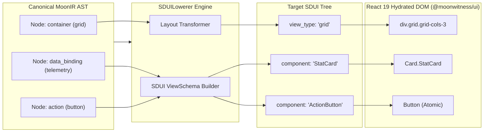

# DESIGN: IR Translation Phase 2 — SDUI Lowering Compiler & Hydration Runtime

## 1. Lowering Pipeline & Component Mapping Flow


## 2. SDUI Component Registry Mapping Table
| MoonIR Node Kind | Target SDUI Primitive | Concrete `@moonwitness/ui` Atomic Component |
|---|---|---|
| `container (layout: grid)` | `grid` | `<div className="grid ...">` (via design token grid) |
| `container (layout: card)` | `card` | `packages/ui/src/components/card.tsx` (`Card`) |
| `data_binding (metric)` | `stat_card` | `packages/ui/src/blocks/stat_card.tsx` |
| `data_binding (table)` | `data_table` | `packages/ui/src/blocks/table.tsx` |
| `action (mutation)` | `action_button` | `packages/ui/src/raw/button.tsx` / `Button` |
| `visualization (graph)` | `chart_view` | `packages/ui/src/components/chart.tsx` |

## 3. Hydration & State Binding Mechanics
- Hydration connects dynamic placeholder values (e.g. `{{ context.activeUsers }}`) with live state stores.
- Actions execute through an isomorphic dispatcher:
  ```ts
  dispatchAction({
    actionId: 'reboot_nas_device',
    endpoint: '/v1/nexus/nas/reboot',
    payload: { nasId: 42 }
  });
  ```
- Optimistic UI updates update component state immediately with automatic rollback on network error.
