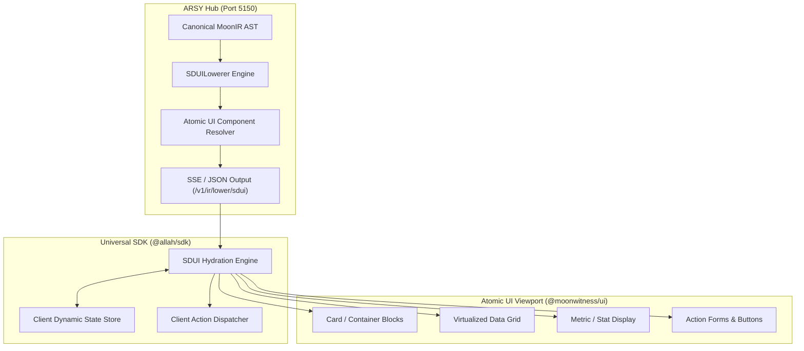

# SPEC: IR Translation Phase 2 — SDUI Lowering Compiler & Hydration Runtime

## 1. Context & Architecture Goal
- **Lowering from AST to UI**: Phase 1 established the canonical `MoonIRTree`. Phase 2 delivers the **SDUI Lowering Compiler** in `@allah/arsy-plugin-ir` that transforms abstract IR nodes into concrete, renderable Server-Driven UI component schemas.
- **Frontend Hydration Engine**: Delivers an isomorphic client runtime `@allah/sdk/sdui` that receives the lowered SDUI payload and resolves state, dynamic data sources, and interactive action handlers.
- **Direct Backend-to-Frontend Binding**: Connects Fastify Hub streaming (`/v1/ir/stream-ui`) directly with client application viewports in `apps/headquarter`, `apps/dock`, and `apps/id`.

---

## 2. Requirements & Deliverables

### 2.1 SDUI Lowering Compiler (`packages/arsy-plugin-ir/src/lowerers/sdui.ts`)
1. Translates `MoonIRNode` hierarchy into concrete `@moonwitness/types` SDUI structures:
   - `kind: 'container'` $\to$ `layout: 'flex' | 'grid'`, atomic Card or Section container.
   - `kind: 'data_binding'` $\to$ Dynamic Table, KPI Metric, or Key-Value List.
   - `kind: 'action'` $\to$ Action Button, Mutation Dialog, or Link Primitive.
   - `kind: 'visualization'` $\to$ LineChart, BarChart, or Network Graph.
2. Emits serialized UI schema with zero client compilation overhead.

### 2.2 Client Hydration Runtime (`packages/sdk/src/sdui/`)
1. `createSDUIRuntime(schema, options)`: Hydrates incoming schema, mounts data bindings to live WebSocket / SSE feeds.
2. Action dispatcher routing clicks and form submissions back to ARSY Hub endpoints.
3. Fallback and error boundary handling: Gracefully displays fallback cards when component mapping is missing.

### 2.3 Headquarter & Dock SDUI Container
- Live dynamic view container component `<SDUIView schema={schema} onAction={handleAction} />` in `packages/ui/src/blocks/sdui_view.tsx`.

---

## 3. Acceptance Criteria
1. Full lowering transformation from 500-node `MoonIRTree` to SDUI schema in $< 10\text{ms}$.
2. `<SDUIView />` mounts and renders dynamic dashboard with $< 50\text{ms}$ Time-to-First-Frame.
3. 100% compliant with `@moonwitness/ui` atomic component standards.
4. Monorepo quality gates (`pnpm docs:check`, `pnpm lint:arch`, `pnpm typecheck`) pass 100%.

