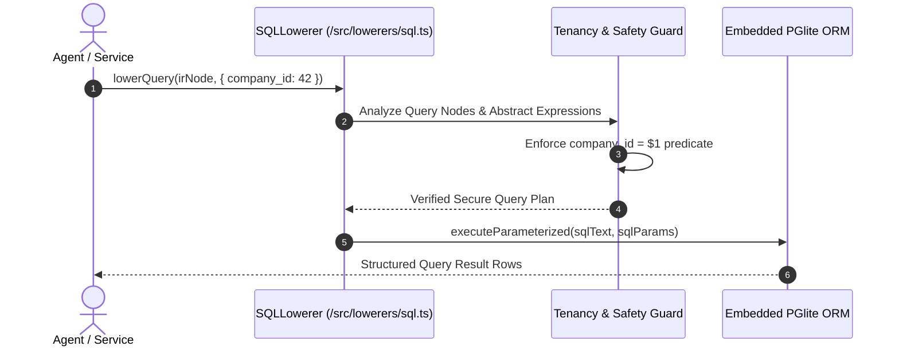

# DESIGN: IR Translation Phase 3 — PGlite SQL Lowerer & Query Planner

## 1. Query Translation Pipeline


## 2. Parameterized Output Contract
Input `MoonIRNode`:
```json
{
  "kind": "data_query",
  "name": "active_pppoe_sessions",
  "attributes": {
    "from": "sentinel_sessions",
    "where": {
      "status": "online",
      "download_bytes": { "$gt": 1048576 }
    },
    "limit": 50
  }
}
```

Generated Parameterized SQL:
```sql
SELECT * FROM sentinel_sessions 
WHERE company_id = $1 AND status = $2 AND download_bytes > $3 
LIMIT $4;
```
Parameters: `[42, "online", 1048576, 50]`

## 3. Defensive Safeguards
- SQL Syntax tree is compiled via structured builder rather than string templating.
- Automatic prevention of multi-statement injection (disallows `;` delimiters).

