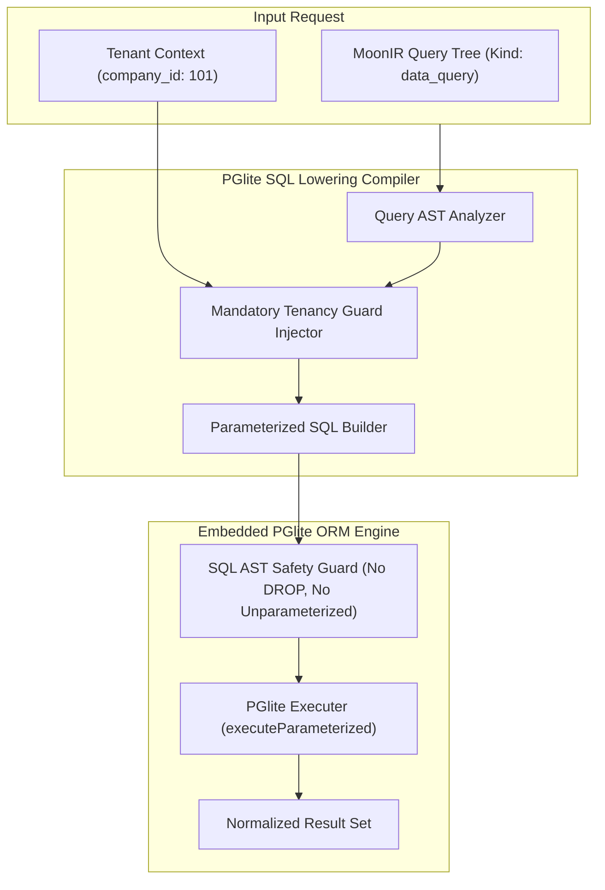

# SPEC: IR Translation Phase 3 — PGlite SQL Lowerer & Query Planner

## 1. Context & Architecture Goal
- **IR to Safe Relational Operations**: In addition to UI synthesis, cognitive agents and business workflows frequently query or mutate relational entities. Phase 3 provides the **PGlite SQL Lowerer** within `@allah/arsy-plugin-ir`.
- **Zero Raw Injection Vulnerability**: Translates abstract `MoonIRNode` queries into strictly parameterized, AST-verified SQL queries compatible with the embedded PGlite ORM (`@allah/arsy-orm`).
- **Automatic Tenancy Invariant Injection**: Automatically appends `WHERE company_id = $1` filters to every generated relational query at the compiler level, eliminating human or agent error.

---

## 2. Requirements & Deliverables

### 2.1 PGlite SQL Lowerer (`packages/arsy-plugin-ir/src/lowerers/sql.ts`)
1. Translates `MoonIRNode` queries:
   - Target selections, inner joins, group-by aggregations, pagination, and sorting.
2. Parameterized extraction:
   - Separates SQL text template from values array `[text, params]`.
3. Invariant Enforcer:
   - Injects mandatory tenant boundary checks (`company_id = ?`) across all root and joined tables.

### 2.2 Transaction & Mutation Plan Generation
- Generates transactional write plans with rollback capabilities for batch creations or updates.
- Emits content-addressed audit events into `CHRONICLE` for every mutation plan.

---

## 3. Acceptance Criteria
1. Generated SQL is 100% parameterized with zero string concatenations.
2. Invariant tests verify that queries attempting to circumvent `company_id` are rejected at compiler time.
3. Query generation benchmark $< 5\text{ms}$ for complex multi-join expressions.
4. Monorepo quality gates (`pnpm docs:check`, `pnpm lint:arch`, `pnpm typecheck`) pass 100%.

