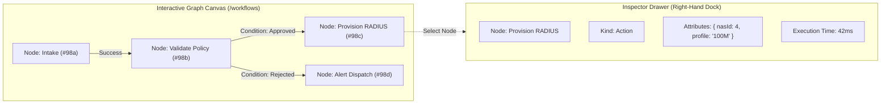

# DESIGN: IR Translation Phase 4 — Frontend Visual Graph & IDE Workbench Canvas

## 1. Visual Canvas Layout & Node Hierarchy
The Visual Graph displays interactive workflows, cognitive agent reasoning traces, and data topologies using `@moonwitness/ui` atomic elements.

## 2. Graph Node Status Visual Design
- **Pending**: Slate/Muted border with subtle pulse.
- **Executing**: Cyan/Teal continuous flowing border with active particle edge animation.
- **Completed**: Emerald/Green solid border with check icon badge.
- **Failed**: Rose/Red highlighted border with error diagnostic tooltip.

## 3. Interaction Mechanics
- Wheel/Pinch to Zoom ($0.25\times$ to $2.0\times$).
- Drag background to pan viewport.
- Click node to open inspection drawer.
- Double-click node to focus and fit to viewport.

