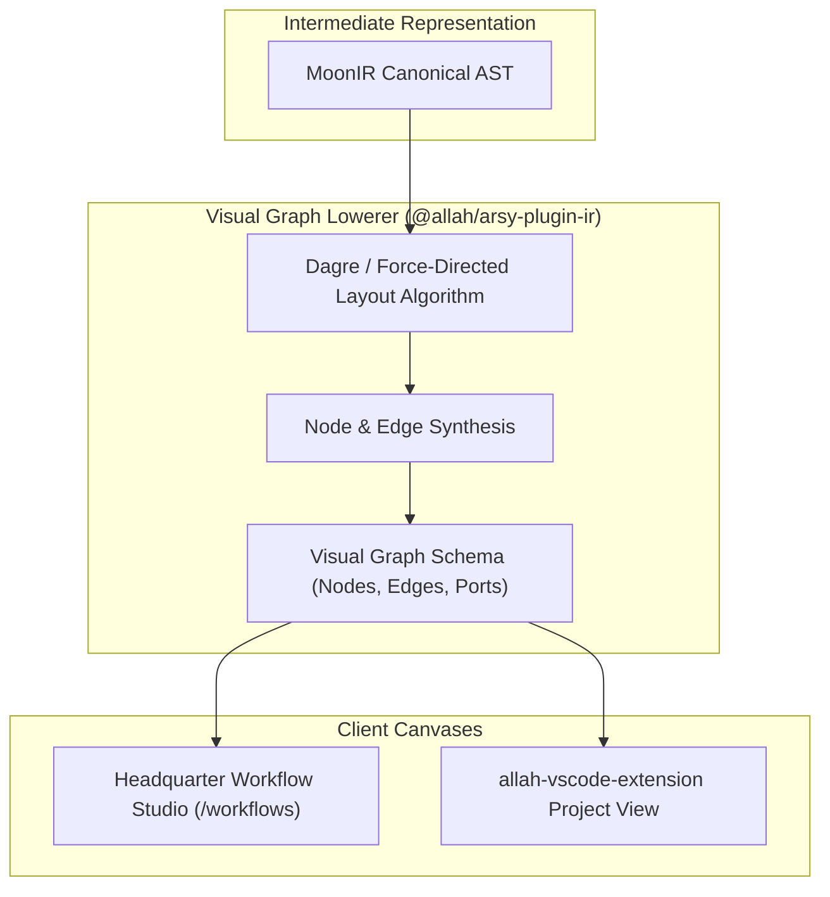

# SPEC: IR Translation Phase 4 — Frontend Visual Graph & IDE Workbench Canvas

## 1. Context & Architecture Goal
- **Visualizing Cognitive Logic & Flow**: While SDUI renders runtime forms and dashboards, operators and engineers require a clear **Visual Flow-Graph** representation of IR pipelines, agent trajectories, and ISP network workflows.
- **Bi-Directional Visual Canvas**: Phase 4 lowers the canonical `MoonIRTree` into interactive Node-Edge graphs rendered within `apps/headquarter` and the `allah-vscode-extension` IDE workbench.
- **Bi-Directional Editing**: Allows operators to inspect, zoom, toggle execution steps, and reconfigure IR node attributes directly via a high-performance visual canvas.

---

## 2. Requirements & Deliverables

### 2.1 Graph Lowering Compiler (`packages/arsy-plugin-ir/src/lowerers/graph.ts`)
1. Translates `MoonIRNode` hierarchy into a normalized Node-Edge topology:
   - Nodes: Position `(x, y)`, dimensions, kind, status (`pending`, `executing`, `completed`, `failed`).
   - Edges: Source node ID, target node ID, transition conditions, animation status.
2. Performs automated orthogonal routing and dependency layering.

### 2.2 Atomic Visual Graph Component (`packages/ui/src/blocks/ir_graph.tsx`)
1. High-density, accessible Canvas/SVG-based graph viewer built strictly with `@moonwitness/ui`.
2. Interactive node selection, pan, zoom, and live step-by-step execution highlights.
3. Node inspection drawer displaying detailed attributes, bindings, and diagnostic traces.

### 2.3 VS Code Extension Canvas Webview
- Embeds the shared `@moonwitness/ui` IR Graph into the VS Code extension webview panel.

---

## 3. Acceptance Criteria
1. Visual graph renders 200+ nodes smoothly at $\ge 60\text{fps}$ with zero jitter.
2. Clicking a node opens inspector panel in $< 30\text{ms}$.
3. Bi-directional node attribute edits serialize back into valid `MoonIRAST` passing validation.
4. Monorepo quality gates (`pnpm docs:check`, `pnpm lint:arch`, `pnpm typecheck`) pass 100%.

