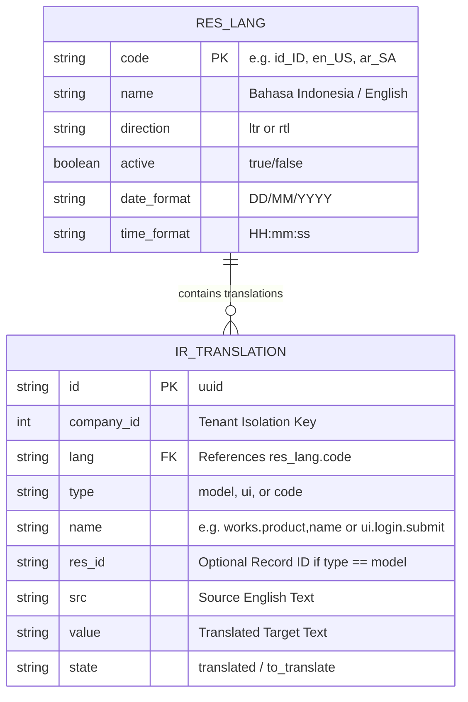

# DESIGN: i18n Localization Phase 1 — Core Translation Models & Addon Schema

## 1. Relational ER Diagram & Translation Architecture


## 2. API Contract Specification
- `GET /v1/i18n/languages`:
  ```json
  {
    "success": true,
    "data": [
      { "code": "en_US", "name": "English (US)", "direction": "ltr", "active": true },
      { "code": "id_ID", "name": "Bahasa Indonesia", "direction": "ltr", "active": true },
      { "code": "ar_SA", "name": "العربية", "direction": "rtl", "active": true }
    ]
  }
  ```
- `GET /v1/i18n/terms/id_ID`:
  ```json
  {
    "success": true,
    "version": "b4c10a",
    "terms": {
      "app.headquarter.title": "Pusat Komando Operasi",
      "works.invoice.status.paid": "Lunas",
      "sentinel.session.disconnect": "Putuskan Sesi"
    }
  }
  ```

## 3. Performance & Caching Strategy
- Translation terms are cached in-memory with SHA-256 ETag generation.
- Response payload is compressed (Gzip/Brotli) resulting in $< 15\text{KB}$ transfer for ~2,000 UI keys.
