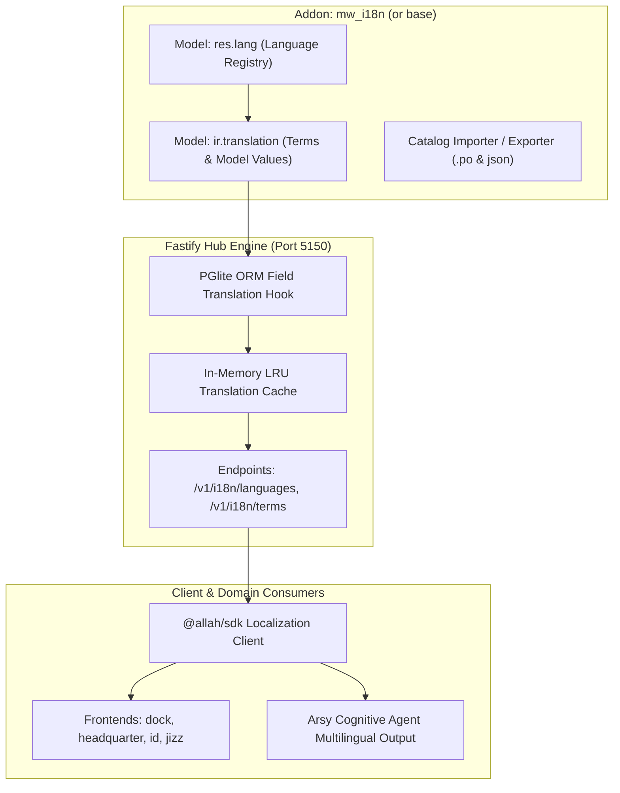

# SPEC: i18n Localization Phase 1 — Core Translation Models & Addon Schema

## 1. Context & Architecture Goal
- **Odoo-Inspired Modular Localization**: Sama seperti Odoo yang memiliki model `res.lang`, `ir.translation`, serta terms catalog per-addon dalam direktori `i18n/*.po` atau JSON dictionaries, A-L-L-A-H.COM memerlukan fondasi translasi kelas enterprise yang modular dan terisolasi per tenant.
- **Dua Pilar Translasi**:
  1. **Static UI & Term Translations (`ir.translation` type: `code`/`ui`)**: Translasi label tombol, header tabel, menu, dan string antarmuka di `apps/*` dan `@moonwitness/ui`.
  2. **Dynamic Model Field Translations (`ir.translation` type: `model`)**: Translasi data dinamis di database (misal: deskripsi paket ISP di `works.product`, nama kategori di `nexus.nas`, term terms contract).
- **Addon Architecture**: Implementasi diletakkan di bawah `addons/mw_i18n` (atau terintegrasi ke `addons/base/models`) dengan schema relational PGlite.

---

## 2. Requirements & Deliverables

### 2.1 PGlite ORM Models (`addons/base/models/`)
1. **`res.lang`**:
   - Fields: `code` (e.g. `id_ID`, `en_US`, `ar_SA`, `zh_CN`, `ja_JP`), `name`, `direction` (`ltr` / `rtl`), `active`, `date_format`, `time_format`, `decimal_separator`, `thousands_separator`.
2. **`ir.translation`**:
   - Fields: `company_id` (mandatory tenant isolation), `lang` (FK `res.lang.code`), `type` (`model` | `ui` | `code`), `name` (e.g. `works.product,name` atau `apps.headquarter.dashboard.title`), `res_id` (ID record database jika tipe `model`), `src` (teks sumber asli, default en_US), `value` (teks terjemahan), `state` (`to_translate` | `translated`).

### 2.2 Model Field Translation Hook di `@allah/arsy-orm`
- Menambahkan opsi `{ translate: true }` pada field definisi ORM (misal: `fields.char({ label: 'Product Name', translate: true })`).
- Saat query `read()` atau `search()` dijalankan dengan header `Accept-Language: id` atau session context `{ lang: 'id_ID' }`, ORM otomatis melakukan transparent join atau cache substitution dari tabel `ir_translation`.

### 2.3 Fastify Hub Endpoints
- `GET /v1/i18n/languages`: Mengembalikan daftar bahasa aktif dan metadata regional (RTL/LTR).
- `GET /v1/i18n/terms/:lang`: Mengembalikan dictionary terkompresi JSON terms untuk UI caching di frontend.
- `POST /v1/i18n/terms/sync`: Endpoint sinkronisasi atau seeding katalog bahasa dari manifest addon.

---

## 3. Acceptance Criteria
1. Skema `res.lang` dan `ir.translation` terdaftar dan termigrasi di PGlite tanpa error.
2. Query model dengan `{ translate: true }` mengembalikan teks bahasa lokal sesuai konteks pengguna dalam $< 2\text{ms}$ (cache-hit).
3. Monorepo quality gates (`pnpm docs:check`, `pnpm lint:arch`, `pnpm typecheck`) pass 100%.

