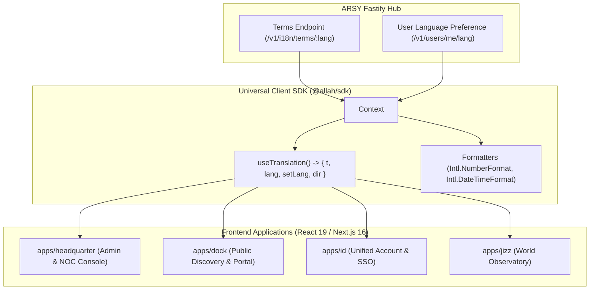

# SPEC: i18n Localization Phase 2 — Frontend Runtime, RTL Layout & Locale Switcher

## 1. Context & Architecture Goal
- **Seamless Isomorphic i18n**: Membawa data translasi dari backend ARSY ke seluruh aplikasi frontend Next.js 16 (`apps/headquarter`, `apps/dock`, `apps/id`, `apps/jizz`) dengan performa tinggi dan zero layout shift.
- **Client Localization Engine (`@allah/sdk/i18n`)**: Menyediakan hook universal `useTranslation()` (`t(key, params)`), format tanggal/angka/mata uang lokal (`formatCurrency`, `formatDate`), dan deteksi preferensi bahasa pengguna (header, cookie, atau `res.users.lang`).
- **Atomic UI Multi-Language Components**: Menambahkan komponen pemilih bahasa (`<LanguageSwitcher />`) dan dukungan native **RTL (Right-to-Left)** pada `@moonwitness/ui` untuk bahasa seperti Arab (`ar_SA`).

---

## 2. Requirements & Deliverables

### 2.1 Universal SDK Localization Engine (`packages/sdk/src/i18n/`)
1. **`I18nProvider`**: React Context Provider yang memuat kamus istilah bahasa aktif, menangani caching di `localStorage` / `IndexedDB`, dan menginjeksi atribut `dir="ltr" | "rtl"` dan `lang="id|en|ar"` ke root element `<html>`.
2. **`useTranslation`**:
   - `t(key: string, variables?: Record<string, any>, fallback?: string): string`
   - Dukungan interpolasi dinamis (misal: `t('welcome.user', { name: 'Ahmad' })` $\to$ `"Selamat datang, Ahmad"`).
3. **Regional Formatters**:
   - `formatCurrency(amount, currencyCode = 'IDR')` $\to$ `Rp 150.000` (ID) vs `$150.00` (EN).
   - `formatDate(timestamp, style = 'medium')`.

### 2.2 Atomic UI Components (`packages/ui/src/blocks/language_switcher.tsx`)
- Komponen dropdown seleksi bahasa yang rapi, responsive, dan terintegrasi dengan active DNA skins.
- Dukungan tailwind RTL variants (`rtl:space-x-reverse`, `rtl:text-right`) pada primitives `@moonwitness/ui`.

### 2.3 SSR & Hydration Safety (Next.js 16 App Router)
- Translation terms diinjeksi via server component context atau cookie untuk mencegah *Flash of Untranslated Content (FOUT)*.

---

## 3. Acceptance Criteria
1. Penggantian bahasa (ID $\leftrightarrow$ EN $\leftrightarrow$ AR) terjadi secara instan tanpa reload halaman penuh ($< 16\text{ms}$).
2. Saat bahasa Arab (`ar_SA`) dipilih, orientasi layout otomatis berbalik (*Right-to-Left*) secara sempurna.
3. Angka dan mata uang diformat sesuai standar lokal masing-masing negara.
4. Monorepo quality gates (`pnpm docs:check`, `pnpm lint:arch`, `pnpm typecheck`) pass 100%.
