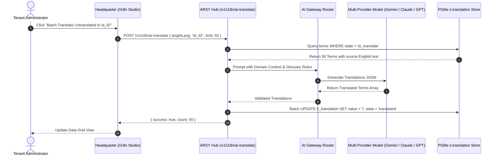

# DESIGN: i18n Localization Phase 3 — AI-Assisted Translation Pipeline & Catalog Sync

## 1. AI Pipeline Sequence Flow

## 2. Technical Glossary Preservation Rules
Prompt engineering guarantees that specific domain terms remain unchanged or standardized:
- **Networking/ISP**: PPPoE, RADIUS, NAS, VLAN, MTU, CIDR, OLT, ONT.
- **Billing/Finance**: Invoice, Prorata, Gateway, Balance, Due Date.
- **Units**: Mbps, Gbps, kWh, kW, V, A, ms.
- **Variables**: `{user}`, `{amount}`, `{code}`, `{date}` must never be translated.

## 3. UI Studio Layout in Headquarter
- Top Filter Bar: Language Selector, Status Dropdown (`All`, `Pending`, `Translated`), Search Input.
- Virtualized Data Grid: Source Key, Source String (en_US), Target Value (Editable inline), Action Icon.
- Bulk Action Footer: "Translate 24 Pending Terms via AI" button with gradient badge.

