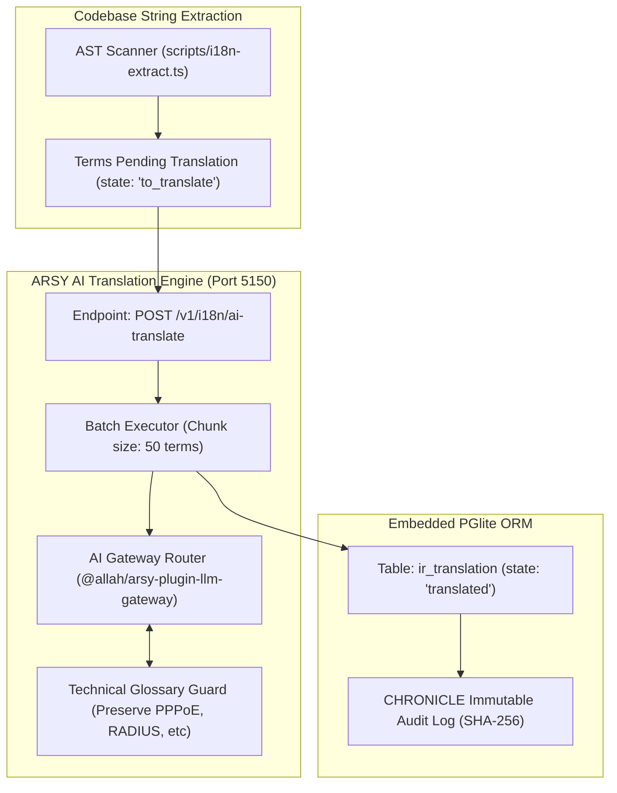

# SPEC: i18n Localization Phase 3 — AI-Assisted Translation Pipeline & Catalog Sync

## 1. Context & Architecture Goal
- **Automated Enterprise Localization**: Sistem monorepo A-L-L-A-H.COM memiliki puluhan domain model dan ribuan UI terms. Manual translation lambat dan sulit konsisten. Phase 3 mengintegrasikan **AI-Assisted Translation Pipeline** ke dalam Fastify Hub (`apps/arsy:5150`).
- **Pemanfaatan AI Gateway Router (`@allah/arsy-plugin-llm-gateway`)**: Memanfaatkan AI Gateway dengan multi-provider fallback untuk mengotomatisasi terjemahan istilah baru (`state: 'to_translate'`) dengan context awareness (domain networking, ISP, works billing, solar energy, cloud compute).
- **Odoo-Style Catalog Synchronization**: Mekanisme sinkronisasi katalog dua arah (ekstraksi AST kode $\leftrightarrow$ tabel `ir.translation` $\leftrightarrow$ file `.po`/`.json` di `addons/*/i18n/`).

---

## 2. Requirements & Deliverables

### 2.1 AST String Extractor Tooling (`scripts/i18n-extract.ts`)
- Menganalisis source code secara statis menggunakan TypeScript compiler API:
  - Ekstraksi pemanggilan `t('key', 'default_string')` di `apps/` dan `packages/`.
  - Ekstraksi model field metadata (`label`, `help`) dari file model `addons/*/models/*.ts`.
- Membandingkan hasil ekstraksi dengan database `ir.translation`, lalu menyisipkan record baru dengan status `to_translate`.

### 2.2 Fastify Hub AI Translation Service (`apps/arsy/src/services/i18n-ai.ts`)
- Endpoint: `POST /v1/i18n/ai-translate`
- Menerapkan prompt domain khusus yang menjaga placeholder variabel (seperti `{user}`, `{count}`, `{amount}`) dan istilah teknis (seperti `PPPoE`, `RADIUS`, `NAS`, `VLAN`, `CIDR`, `kWh`).
- Menyimpan hasil terjemahan secara atomik di PGlite `ir_translation` dan memperbarui cache in-memory.

### 2.3 Headquarter Translation Studio UI (`apps/headquarter/src/app/i18n/page.tsx`)
- Antarmuka manajemen translasi berbasis `@moonwitness/ui`:
  - Data table virtualized menampilkan seluruh terms.
  - Filter bahasa (`id_ID`, `en_US`, `ar_SA`), status (`to_translate`, `translated`), dan model domain.
  - Tombol aksi "Batch Translate via AI" dengan live progress indicator.

---

## 3. Acceptance Criteria
1. String extractor mendeteksi seluruh key translasi tanpa error atau false-positive.
2. AI Translation Service mempertahankan 100% placeholder variabel `{...}` dan istilah teknis.
3. Terjemahan tersimpan ke `ir.translation` dan langsung aktif di frontend via ETag cache revalidation.
4. Monorepo quality gates (`pnpm docs:check`, `pnpm lint:arch`, `pnpm typecheck`) pass 100%.

