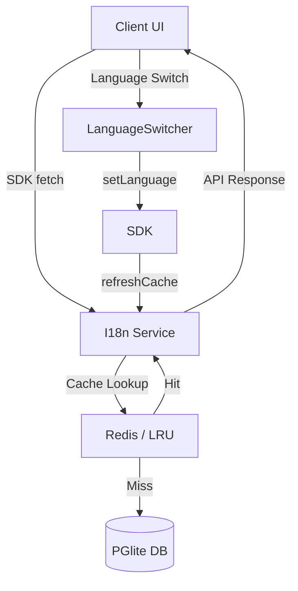

# i18n Extended Overview – Design

## Architecture Summary
- **Core Models** (`res.lang`, `ir.translation`) remain unchanged – shared across all phases.
- **i18n Service Layer** (`apps/arsy/src/services/i18n.ts`) acts as façade for SDK and UI.
- **Cache Stack** – In‑memory LRU for dev, Redis for prod, TTL 5 min, cache key `i18n:{company_id}:{lang}`.
- **Rate‑Limit Middleware** – per‑tenant QPS configurable via env `I18N_QPS_LIMIT`.
- **API Endpoints** – `GET /v1/i18n/languages`, `GET /v1/i18n/terms/:lang`, `POST /v1/i18n/ai-translate`.
- **Frontend Runtime** – `packages/sdk/src/i18n/` provides `useTranslation`, `setLanguage`, and `refreshCache` hooks.
- **Language Switcher** – atomic component (see separate plan).
- **Extraction Tool** – CLI `pnpm i18n:extract` scans source files for `t('key')` usages and updates `ir.translation`.
- **CI Validation** – lint step `pnpm i18n:validate` ensures no missing keys and runs snapshot UI tests for LTR/RTL.
- **Observability** – `apps/arsy/src/plugins/i18n-metrics.ts` emits Prometheus counters (`i18n_requests_total`, `i18n_cache_hits`, `i18n_rate_limited`).
- **Security** – all endpoints validated against tenant `company_id`; role‑based access for write ops.

## Data Flow Diagram

## Key Decisions
- **Cache‑First Strategy** to minimise DB load.
- **Redis as Single Source of Truth** for multi‑instance deployments.
- **TTL 5 min** balances freshness vs. load.
- **Rate‑Limit** defaults to 30 QPS per tenant, adjustable per SLA.
- **AI Translation** runs asynchronously; results stored in `ir.translation` with `source='ai'` flag.

---
