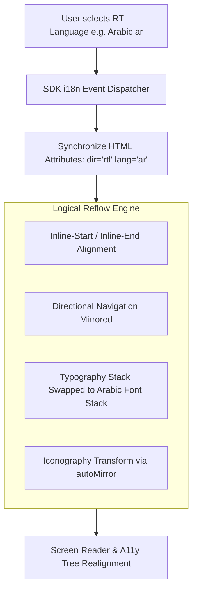

# Architectural Design: i18n Bidirectional RTL Layout & Universal WCAG 2.2 AA Accessibility Engine

## 1. Directional Layout Architecture


## 2. Iconography Mirroring Strategy
```tsx
// Icon rendering contract
export interface IconProps extends React.SVGProps<SVGSVGElement> {
  autoMirror?: boolean; // When true, flips horizontally in RTL layout
}

export function Icon({ autoMirror = false, className, ...props }: IconProps) {
  return (
    <svg
      className={cn(autoMirror && "rtl:scale-x-[-1] transition-transform", className)}
      {...props}
    />
  );
}
```

## 3. WCAG 2.2 AA Testing Harness
- Integration of `@axe-core/playwright` into E2E testing pipelines.
- Color contrast minimum ratio: 4.5:1 for normal text, 3:1 for large text.
- Focus outlines explicitly defined using `outline-offset` to avoid clipping in both LTR and RTL orientations.

