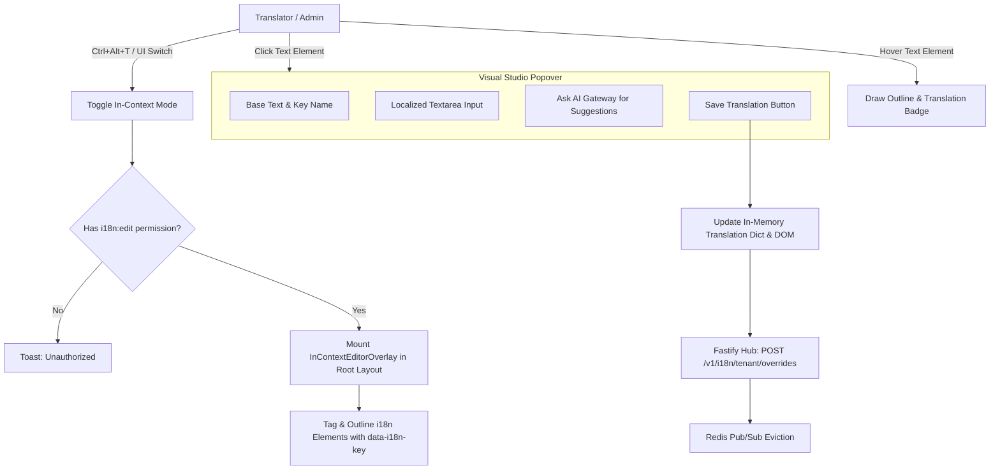

# Architectural Design: i18n In-Context Visual Translation Editor & Live DOM Overlay

## 1. Live Overlay Architecture


## 2. DOM Node Tagging Contract
When `inContextEditMode = true`, strings rendered by the i18n hook render wrapped with inspection markers:
```html
<span 
  data-i18n-key="dashboard.header.welcome" 
  data-i18n-status="translated"
  data-i18n-lang="id_ID"
  class="i18n-editable-node"
>
  Selamat datang di Command Center
</span>
```
When `inContextEditMode = false`, string output is clean plain text or transparent fragment with zero wrapper overhead.

## 3. Security & Injection Protection
- Inputs entered through the visual popover are strictly sanitized before persisting to avoid stored XSS.
- The overlay bundle is lazily loaded via dynamic import to preserve lean initial bundle sizes for regular visitors.

