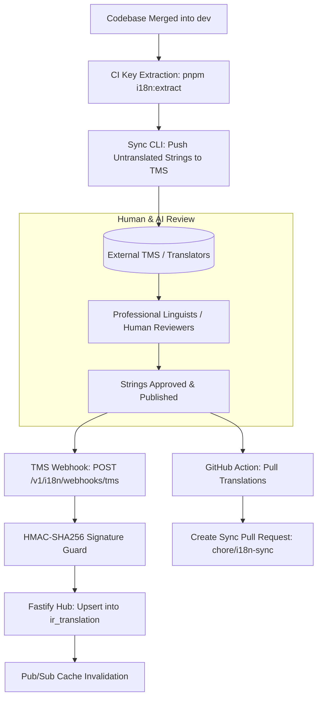

# Architectural Design: i18n Continuous Localization CI/CD & TMS Sync Engine

## 1. Synchronization Flow Architecture


## 2. Webhook Security Contract
- Header: `X-TMS-Signature: sha256=<hex_digest>`
- Payload:
```json
{
  "event": "translation.published",
  "project_id": "allah-ecosystem",
  "lang": "id_ID",
  "terms": [
    {
      "key": "auth.login.title",
      "value": "Masuk ke Akun Anda",
      "translator": "linguist_01"
    }
  ]
}
```

## 3. Versioning & Reconciliation Rules
- Translations with `state = 'verified'` take precedence over untranslated or machine-translated drafts.
- Term removals are marked obsolete rather than hard-deleted to prevent accidental data loss.

