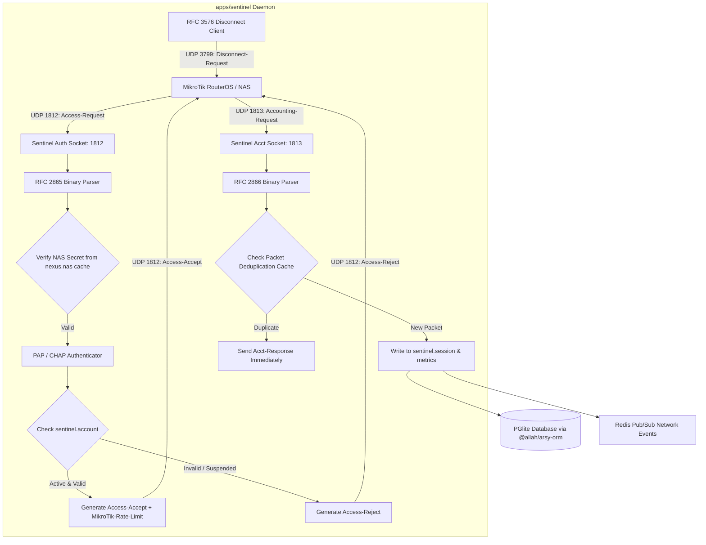

# Architectural Design: Sentinel Standalone Microservice Daemon (`apps/sentinel`) & High-Performance UDP RADIUS Service

## 1. System Topology & Flow Architecture


## 2. Packet Buffer Layout (RFC 2865)
```
 0                   1                   2                   3
 0 1 2 3 4 5 6 7 8 9 0 1 2 3 4 5 6 7 8 9 0 1 2 3 4 5 6 7 8 9 0 1
+-+-+-+-+-+-+-+-+-+-+-+-+-+-+-+-+-+-+-+-+-+-+-+-+-+-+-+-+-+-+-+-+
|     Code      |  Identifier   |            Length             |
+-+-+-+-+-+-+-+-+-+-+-+-+-+-+-+-+-+-+-+-+-+-+-+-+-+-+-+-+-+-+-+-+
|                                                               |
|                         Authenticator                         |
|                           (16 octets)                         |
|                                                               |
+-+-+-+-+-+-+-+-+-+-+-+-+-+-+-+-+-+-+-+-+-+-+-+-+-+-+-+-+-+-+-+-+
|  Attributes ...
```

## 3. MikroTik Rate Limit VSA Specification
- **Vendor ID**: `14988` (MikroTik)
- **Attribute Type**: `1` (`MikroTik-Rate-Limit`)
- **Format**: `rx-rate[/tx-rate] [rx-burst-rate[/tx-burst-rate]] ...`
- **Example Value**: `"20M/50M"` (20 Mbps upload, 50 Mbps download)

## 4. Port Allocations
- UDP `1812`: RADIUS Authentication & Authorization.
- UDP `1813`: RADIUS Accounting.
- UDP `3799`: RADIUS CoA / Disconnect-Request (outbound from Sentinel to NAS).
- HTTP `9181`: Sentinel Observability & Health (`/metrics`, `/healthz`).
