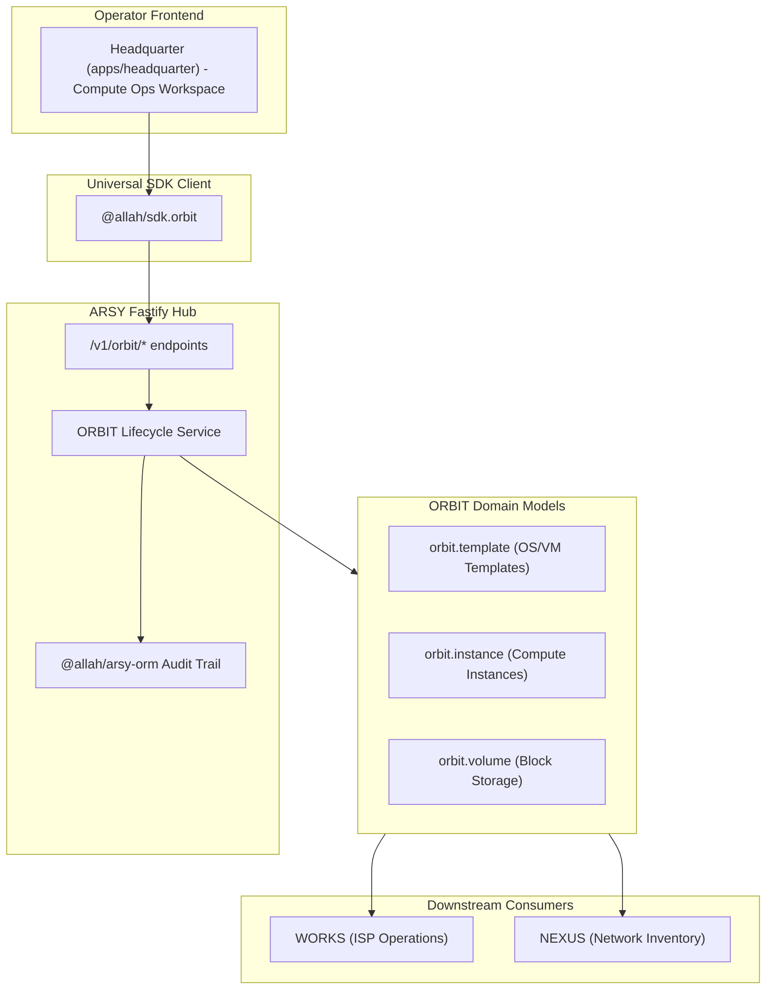

# SPEC: ORBIT Phase 1 — Cloud Compute Lifecycle Orchestration

## 1. Context & Purpose
- **Scope**: GitHub Issue #22 — `[ORBIT] Build cloud compute lifecycle orchestration foundation`.
- **Purpose**: Activate the dormant `addons/orbit` models (`orbit.instance`, `orbit.template`, `orbit.volume`) into a fully operational lifecycle system with state machine transitions, template catalog management, volume lifecycle, and operator-facing management capabilities integrated with the existing ARSY hub, SDK, and Headquarter operator workspace.
- **Parent Master Issue**: GitHub Issue #5.
- **Rule**: ORBIT provides compute orchestration as an addon to the single ARSY Fastify Hub. No secondary backend or database. All state transitions are tenant-scoped, auditable, and enforced server-side.

## 2. Requirements & Deliverables

### 2.1 Domain Model Extensions
1. **`orbit.template`** (existing, extend): Add fields for validation — `architecture` (x86_64/arm64), `min_cpu`, `min_ram_mb`, `min_disk_gb`, `is_active`, `cloud_init_supported`. Maintain backward compatibility with existing fields.
2. **`orbit.instance`** (existing, extend): Add lifecycle metadata — `node_id`, `started_at`, `stopped_at`, `terminated_at`, `last_state_change_at`, `error_message` (redacted), `metadata` JSON. Add `rebooting` to status enum. Enforce valid state transitions.
3. **`orbit.volume`** (existing, extend): Add lifecycle fields — `status` (provisioning/available/in_use/detached/error), `created_at`, `attached_at`, `detached_at`, `filesystem_type`, `encrypted`. Support attach/detach operations with referential validation.

### 2.2 Lifecycle State Machine
Define strict valid transitions for instances:
- `provisioning` → `running`, `terminated` (on failure)
- `running` → `stopped`, `rebooting`, `terminated`
- `rebooting` → `running`, `stopped` (on failure), `terminated`
- `stopped` → `running`, `terminated`
- `terminated` → (terminal, no transitions out)

All transitions logged to audit trail with actor, reason (where applicable), and previous/new state.

### 2.3 ORBIT Service Layer
Create `apps/arsy/src/services/orbit.ts` with:
- `createInstance()` — validates template constraints (CPU/RAM/DISK >= template minimums), sets initial state to `provisioning`, schedules transition to `running` after validation, emits audit event
- `startInstance()`, `stopInstance()`, `rebootInstance()`, `terminateInstance()` — enforce state machine, validate permissions, audit
- `listTemplates()`, `createTemplate()` — manage catalog (superuser/admin only for mutations)
- `createVolume()`, `attachVolume()`, `detachVolume()`, `deleteVolume()` — lifecycle with instance validation

### 2.4 Management APIs
Fastify endpoints under `/v1/orbit/`:
- `GET /v1/orbit/templates` — List available templates (tenant-scoped)
- `POST /v1/orbit/templates` — Create template (admin/superuser only)
- `GET /v1/orbit/instances` — List instances (tenant-scoped)
- `POST /v1/orbit/instances` — Create instance (validates template)
- `GET /v1/orbit/instances/:id` — Get instance details
- `POST /v1/orbit/instances/:id/start` — Start stopped instance
- `POST /v1/orbit/instances/:id/stop` — Stop running instance
- `POST /v1/orbit/instances/:id/reboot` — Reboot running instance
- `POST /v1/orbit/instances/:id/terminate` — Terminate instance (requires confirmation flag)
- `GET /v1/orbit/volumes` — List volumes
- `POST /v1/orbit/volumes` — Create volume
- `POST /v1/orbit/volumes/:id/attach` — Attach to instance
- `POST /v1/orbit/volumes/:id/detach` — Detach from instance
- `DELETE /v1/orbit/volumes/:id` — Delete unattached volume

### 2.5 SDK Extension
Add `@allah/sdk.orbit` namespace with typed methods matching all endpoints:
- `listTemplates()`, `createTemplate(payload)`
- `listInstances()`, `createInstance(payload)`, `getInstance(id)`
- `startInstance(id)`, `stopInstance(id)`, `rebootInstance(id)`, `terminateInstance(id, confirm)`
- `listVolumes()`, `createVolume(payload)`, `attachVolume(id, instanceId)`, `detachVolume(id)`, `deleteVolume(id)`

### 2.6 Headquarter Operator Workspace
Add `/orbit` route to Headquarter app (`apps/headquarter/src/app/orbit/`) with:
- Instance list with status badges, actions (start/stop/reboot/terminate)
- Template catalog view
- Volume management panel
- Create instance wizard using `@moonwitness/ui` composition blocks only
- StatePanel for loading/error/empty states
- SkinRoot already applied via Headquarter layout (Nexus Paradox)

### 2.7 Documentation
Update ROADMAP/BACKLOG references as needed. Ensure `pnpm docs:check` passes.

## 3. Non-Goals
1. **Actual hypervisor integration** — This phase implements orchestration logic, state machine, and API contracts. Real provisioning to hypervisors is a future phase.
2. **Network/firewall configuration** — VPC, security groups out of scope.
3. **Billing/quotas enforcement** — Charge-back logic deferred.
4. **SSH key management UI** — Deferred to future phase.
5. **Snapshot/backups** — Volume snapshots out of scope.

## 4. Acceptance Criteria
1. All ORBIT models have lifecycle fields added with backward-compatible migrations via `SchemaMigrator.sync()`.
2. State machine enforces valid transitions; invalid transitions return 409 with clear errors.
3. All ORBIT endpoints enforce tenant isolation and authentication.
4. SDK `orbit` namespace fully typed with all operations.
5. Headquarter `/orbit` page renders with `@moonwitness/ui` components only (lint:arch passes).
6. Audit events recorded for all instance state changes and volume attachments.
7. Templates enforce minimum resource constraints on instance creation.
8. Terminate requires explicit confirmation flag to prevent accidental deletion.
9. All monorepo quality gates pass: `pnpm docs:check`, `pnpm lint:arch`, `pnpm typecheck`, `pnpm headquarter:build`.
10. No secrets logged, no raw HTML controls, no direct fetch in app code.