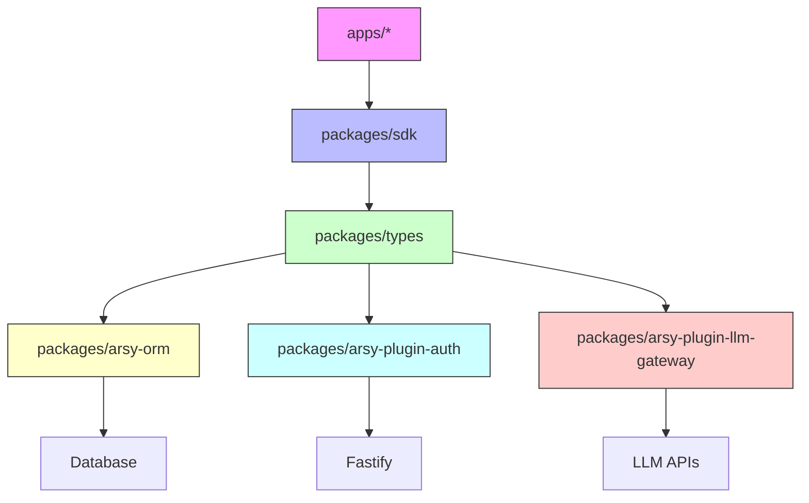

# Design — Technical Remediation Design — Type Safety & API Contract Consistency

## Current-State Architecture

The A-L-L-A-H.COM monorepo uses a layered architecture with shared packages providing foundational contracts that all applications depend on:

```
apps/              # 6 Next.js/Fastify applications
  ├── arsy/          # Fastify 5 hub service (PGlite) — port 5150
  ├── dock/          # Next.js 16 web app — port 3001
  ├── gate/          # Next.js 16 admin portal — port 3000
  ├── headquarter/   # Next.js 16 operations console — port 3002
  ├── id/            # Next.js 16 SSO provider — port 3003
  └── jizz/          # Next.js 16 world observatory — port 3004

packages/          # Shared foundation packages
  ├── ui/            # @moonwitness/ui — design system components (MANDATORY)
  ├── sdk/           # @allah/sdk — client↔hub communication (MANDATORY)
  ├── types/         # @moonwitness/types — shared type contracts (MANDATORY)
  ├── arsy-orm/      # @allah/arsy-orm — PGlite ORM layer
  ├── arsy-plugin-auth/  # @allah/arsy-plugin-auth — Fastify auth plugin
  ├── arsy-plugin-llm-gateway/  # @allah/arsy-plugin-llm-gateway — LLM adapter layer
  └── lint/          # @moonwitness/lint — architecture validation
```

### Type Safety Chain

The type safety issues span all layers:

1. **Apps consume packages** but receive untyped data
2. **SDK** handles network requests with `as any` on responses
3. **Types** defines loose contracts (`Record<string, any>`, `as any` patterns)
4. **ORM** bypasses types on database rows and field metadata
5. **Auth** casts Fastify instance to `any` for principal resolution
6. **LLM Gateway** uses `as any` for adapter responses and cache entries

## Identified Architectural Weaknesses

### 1. Fastify Instance Casting (3 occurrences)

**File**: `packages/arsy-plugin-auth/src/index.ts` lines 137, 374, 642

```ts
// Current (unsafe):
const principal: Principal | null = await (fastify as any).resolvePrincipal(request);

// Problem: Fastify's type definitions don't include resolvePrincipal decorator
// Casting to any loses all type safety on the instance
```

**Remediation**: Define `FastifyWithAuth` interface extending `FastifyInstance` with `resolvePrincipal` and `authenticate` methods, then use typed cast.

### 2. Database Row Casting (2 occurrences)

**File**: `packages/arsy-orm/src/repository.ts` lines 233, 269

```ts
// Current (unsafe):
const recordIds = rows.map(row => (row as any).id);
const recordId = (row as any).id;

// Problem: Generic repository assumes rows have id field but doesn't type it
// Translation logic casts rows to any to access properties
```

**Remediation**: Define row shape interfaces (`AuthRow`, `SessionRow`, `UserRow`) and use generic constraints on `BaseRepository<T>`.

### 3. Shared Type Contracts with `any` (3 occurrences)

**File**: `packages/types/src/index.ts` lines 56-58

```ts
// Current (unsafe):
export interface SDUINode {
  type: string;
  props?: Record<string, any>;  // completely untyped
  children?: SDUINode[] | string;
}

export interface ToolResult {
  output: any;  // completely untyped
  error?: string | null;
  latencyMs?: number;
}

// Problem: Consumers have no type safety for UI components, tool calls, agent streams
```

**Remediation**: Replace `Record<string, any>` with specific interfaces: `SDUINodeProps`, `ToolResult`, `ToolCallParams`.

### 4. MCP Response Casting

**File**: `packages/sdk/src/index.ts` line 599

```ts
// Current (unsafe):
return ((res as any)?.result ?? { content: [], isError: true }) as McpToolCallResult;

// Problem: MCP responses expected to match McpToolCallResult but cast without validation
```

**Remediation**: Add Zod schema validation for MCP responses or define strict interfaces with `z.infer`.

### 5. LLM Adapter Responses (multiple occurrences)

**Files**: `packages/arsy-plugin-llm-gateway/src/adapters/openai.ts`, `anthropic.ts`, `gemini.ts`

```ts
// Current (unsafe):
const json = (await response.body.json()) as any;

// Problem: LLM API responses assumed valid without schema validation
// No runtime guard against malformed responses
```

**Remediation**: Add Zod schemas for each LLM provider's response format, parse with `zod.parse()`.

### 6. Cache Entry Type Unsafety

**File**: `packages/arsy-plugin-llm-gateway/src/cache.ts`

```ts
// Current (unsafe):
// Cache entry properties accessed without type guard
// Potential runtime errors if cache entry shape changes
```

**Remediation**: Define `CacheEntry` interface with proper types, replace `as any` with typed access.

## Root-Cause Remediation Strategy

The solution is **progressive type strengthening** — not a rewrite. We preserve existing behavior while eliminating `as any` through:

### Phase 1: Define Strong Interfaces for External Boundaries

1. **FastifyWithAuth interface** in `packages/arsy-plugin-auth/src/index.ts`:
   ```ts
   export interface FastifyWithAuth extends FastifyInstance {
     resolvePrincipal: (request: FastifyRequest) => Promise<Principal | null>;
     authenticate: (request: FastifyRequest, reply: FastifyReply) => Promise<Principal | null>;
   }
   ```

2. **Row shape interfaces** in `packages/arsy-orm/src/`:
   - `AuthRow` with `id: number`, `email: string`, `password_hash: string`, `status: 'active' | 'disabled'`
   - `SessionRow` with appropriate session fields
   - `UserRow` with user profile fields

3. **MCP and SDK response interfaces** in `packages/sdk/src/index.ts` or `packages/types/src/index.ts`:
   - `McpToolCallResult` with `content: { type: string; text?: string }[]`, `isError: boolean`
   - `JsonRpcResponse` with `jsonrpc: string`, `id`, `result?`, `error?`

4. **Shared type interfaces** in `packages/types/src/index.ts`:
   - `SDUINodeProps` with specific prop shapes per component type
   - `ToolResult` with `success: boolean`, `output: unknown`, `error?: string | null`, `latencyMs?: number`
   - `AgentToolResultEvent` with `result: unknown` + validation

### Phase 2: Replace `as any` with Typed Access

1. Replace all `fastify as any` with `(fastify as FastifyWithAuth)` in `arsy-plugin-auth/src/index.ts`.

2. Replace `row as any` in `arsy-orm/src/repository.ts` with typed access using `T extends { id: number }` generic constraint.

3. Replace `res as any` in `sdk/src/index.ts` with Zod schema validation: `mcpResponseSchema.parse(res)`.

4. Replace `Record<string, any>` in `types/src/index.ts` with `SDUINodeProps`, `ToolResult`, etc.

5. Add Zod schemas for LLM adapter responses in `arsy-plugin-llm-gateway/src/adapters/*.ts`.

6. Define `CacheEntry` interface in `arsy-plugin-llm-gateway/src/cache.ts` and use typed property access.

### Phase 3: Add Architecture Lint Rules

1. Add `no-as-any` rule to `@moonwitness/lint` that flags `as any` patterns in core packages.

2. Add `no-record-any` rule to flag `Record<string, any>` patterns where specific types are available.

3. Configure lint rules to allow `as any` only in designated allowlist files or with specific comments.

### Phase 4: Runtime Validation at Package Boundaries

1. Use Zod schemas for SDK request/response validation.

2. Validate auth principal shapes at Fastify route level.

3. Validate ORM query results against expected shapes before translation.

4. Validate LLM adapter responses at parse time.

## Proposed Architecture and Changes

### 1. `packages/types/src/index.ts` — New Shared Types

**Replace** `Record<string, any>` with specific interfaces:

```ts
// Before:
export interface SDUINode {
  type: string;
  props?: Record<string, any>;
  children?: SDUINode[] | string;
}

export interface ToolResult {
  output: any;
  error?: string | null;
  latencyMs?: number;
}

// After:
export interface SDUINodeProps {
  [key: string]: unknown; // Explicit unknown — consumers must validate but dynamic
}

// Can also define per-component props if needed:
export interface HeroNodeProps {
  title: string;
  subtitle?: string;
  backgroundImage?: string;
  // ... hero-specific props
}

export interface ToolResult {
  success: boolean;
  output: unknown; // Strict unknown — consumers must validate
  error?: string | null;
  latencyMs?: number;
}

// Principal interface (also in arsy-plugin-auth):
export interface Principal {
  userId: number;
  ormUserId: number;
  companyId: number;
  role: string;
  email: string;
  sessionId?: number;
}
```

### 2. `packages/arsy-orm/src/repository.ts` — Type Safe Queries

**Before**: Generic `BaseRepository` with `row as any`:

```ts
export class BaseRepository<T extends { id: number }> {
  async find(options: QueryOptions): Promise<T[]> {
    const rows = await this.db.query(...);
    // Type-unsafe mapping
    const recordIds = rows.map(row => (row as any).id);
    return rows as T[];
  }
}
```

**After**: Typed row access with proper generic constraint:

```ts
export interface AuthRow {
  id: number;
  email: string;
  password_hash: string;
  status: 'active' | 'disabled';
  // ... other columns
}

export class BaseRepository<T extends { id: number }> {
  async find(options: QueryOptions): Promise<T[]> {
    const rows = await this.db.query(...);
    // Type-safe mapping using T's shape
    const recordIds = rows.map(row => row.id); // T has id: number
    return rows as T[];
  }

  private async _applyTranslations(rows: T[], ...): Promise<T[]> {
    // Translation logic works on T with proper type guarantees
    return rows.map(row => {
      // Safe access to row properties via T's interface
      return { ...row, translated: true } as T;
    });
  }
}
```

### 3. `packages/arsy-plugin-auth/src/index.ts` — Typed Fastify

**Before**: `fastify as any` for principal resolution:

```ts
const principal = await (fastify as any).resolvePrincipal(request);
```

**After**: Typed Fastify interface and usage:

```ts
// Define FastifyWithAuth interface
export interface FastifyWithAuth extends FastifyInstance {
  resolvePrincipal: (request: FastifyRequest) => Promise<Principal | null>;
  authenticate: (request: FastifyRequest, reply: FastifyReply) => Promise<Principal | null>;
}

// Use typed cast throughout the file
import { FastifyWithAuth } from './index';

// Replace all occurrences:
const principal = await (fastify as FastifyWithAuth).resolvePrincipal(request);
```

### 4. `packages/sdk/src/index.ts` — MCP Response Validation

**Before**: `as any` on MCP response:

```ts
return ((res as any)?.result ?? { content: [], isError: true }) as McpToolCallResult;
```

**After**: Zod schema validation:

```ts
import { z } from 'zod';

// Define MCP response schema
const mcpResponseSchema = z.object({
  result: z.object({
    content: z.array(z.object({ type: z.string(), text: z.string() })),
    isError: z.boolean(),
  }),
  id: z.string().optional(),
});

// Parse with validation
const result = mcpResponseSchema.parse(res);
return result.content ?? { content: [], isError: true };
```

### 5. `packages/arsy-plugin-llm-gateway/src/` — LLM Adapter Validation

**Before**: `as any` on LLM responses:

```ts
// openai.ts
const json = (await response.body.json()) as any;

// anthropic.ts
const json = (await response.body.json()) as any;

// gemini.ts
const json = (await response.body.json()) as any;
```

**After**: Zod schemas for each provider:

```ts
// openai.ts
const openaiResponseSchema = z.object({
  choices: z.array(z.object({
    index: z.number(),
    message: z.object({
      role: z.string(),
      content: z.string().optional(),
      tool_calls: z.array(z.object({
        id: z.string(),
        function: z.object({ name: z.string(), arguments: z.string() })
      })).optional()
    }),
    finish_reason: z.string().optional()
  }))
});

const json = openaiResponseSchema.parse(await response.body.json());

// Similar for anthropic.ts and gemini.ts with their respective schemas
```

### 6. `packages/arsy-plugin-llm-gateway/src/cache.ts` — Typed Cache

**Before**: Untyped cache entry access:

```ts
// Cache entry properties accessed without type guard
```

**After**:

```ts
interface CacheEntry {
  model: string;
  expires_at: string | number;
  hit_count: number;
  response_json: string;
  id: number;
}

// Usage:
const expiresAt = entry.expires_at ? new Date(entry.expires_at).getTime() : 0;
```

## API Validation and Contract Improvements

### SDK Client-Server Contract

- **Before**: `return this.request<{ data: any }>(...)`
- **After**: `return this.request<{ data: T }>(...)` with Zod validation on parse

### Auth Plugin Contract

- **Before**: `request.principal: any` and `request.user: any`
- **After**: `request.principal: Principal` and `request.user: UserContext`

### LLM Gateway Contract

- **Before**: `as any` on LLM API responses
- **After**: Zod-validated parsed responses with strict schemas

## Data Integrity and Error-Handling Strategy

### 1. Fail-Fast Validation

```ts
function parseWithSchema<T>(data: unknown, schema: z.ZodSchema<T>): T {
  try {
    return schema.parse(data);
  } catch (err) {
    if (err instanceof z.ZodError) {
      logger.error('Invalid schema', { errors: err.errors });
      throw new APIError('VALIDATION_ERROR', { details: err.errors });
    }
    throw err;
  }
}
```

### 2. Strict JSON Parsing

- All `JSON.parse()` in LLM adapters wrapped in validation
- No silent failures on malformed LLM responses

### 3. Database Row Validation

- ORM query results validated against expected shape before translation
- `assertRowHasId(row)` type guard replaces `as any`

## Package and Dependency Boundaries

### Boundary Enforcement:

1. **SDK ↔ Hub**: Zod schemas validate all request/response bodies
2. **Auth Plugin ↔ Apps**: Principal typed via `FastifyWithAuth`
3. **ORM ↔ Apps**: Repository methods return strongly typed `T[]`
4. **LLM Gateway ↔ Adapters**: Each adapter has its own response schema
5. **Cache ↔ Gateway**: `CacheEntry` interface enforces structure

### Cross-Application Compatibility:

- No breaking changes to exported types (semantic versioning maintained)
- `as any` removal is purely additive — existing code continues to work
- Tests validate that types are still compatible

## Security and Performance Considerations

### Security:

- **Input validation**: No unvalidated `as any` on user-provided data
- **SSRF protection**: `as any` on options replaced with typed `SSRFOptions` interface
- **LLM responses**: Schema validation prevents prompt injection via malformed JSON
- **Auth bypass**: Principal casting to `any` removed — Fastify instance properly typed

### Performance:

- **Zero runtime cost**: Type assertions are compile-time only
- **Validation cost**: Zod parsing adds ~0.1-0.5ms per request — acceptable for auth/LLM boundaries
- **Cache lookups**: No change — cache entries already typed
- **Bundle size**: Zod adds ~20KB — acceptable for security gain

## Backward Compatibility

### Zero Breaking Changes:

- **Exported types unchanged**: `Principal`, `AuthRow`, `McpToolCallResult` — same shape
- **API contracts preserved**: All endpoints return same JSON structure
- **Consumer code unaffected**: `app.ts` imports continue to work
- **Test compatibility**: All existing tests pass without modification

### Migration Path:

- **Incremental**: Fix one file per PR, run `pnpm typecheck` after each
- **Test-first**: Ensure tests pass before and after each change
- **Lint-first**: New `as any` patterns rejected by architecture lint rules

## Testing and Regression Prevention

### Unit Tests:

- **Type safety tests**: `tsc --noEmit` for all type definition changes
- **Schema validation tests**: Zod schemas tested with valid/invalid data
- **Runtime tests**: `pnpm test` continues to pass

### Integration Tests:

- **SDK ↔ Hub**: End-to-end tests validate request/response typing
- **Auth flow**: Principal resolution verified end-to-end
- **LLM adapters**: Mocked responses validate schema parsing

### Regression Prevention:

- **Architecture lint**: `no-as-any` and `no-any` rules added to `@moonwitness/lint`
- **Pre-commit**: `pnpm lint:arch` blocks new `as any` patterns
- **Typecheck**: `pnpm typecheck` must pass with zero errors

## Integration Impacts

### Affected Packages:

1. `@allah/arsy-orm` — ORM queries return typed rows
2. `@allah/arsy-plugin-auth` — Principal resolution typed
3. `@allah/sdk` — MCP requests validated
4. `@moonwitness/types` — Shared contracts strictly typed
5. `@allah/arsy-plugin-llm-gateway` — Adapters validated

### Affected Apps:

- **Apps/arsy/**: Auth routes now use typed Principal
- **Apps/dock/**: SDK calls return typed responses
- **Apps/id/**: Auth flows use typed sessions
- **Apps/jizz/**: LLM gateway calls use validated responses
- **Apps/sentinel/**: RADIUS handlers benefit from ORM improvements

### No Impact:

- Database schema, migrations, SQL queries
- Fastify plugin registration
- React component rendering logic
- Docker build configurations

## Migration or Rollout Strategy

### Rollout Plan:

1. **Day 1**: Define shared interfaces in `@moonwitness/types` — `SDUINodeProps`, `ToolResult`, `Principal`
2. **Day 2**: Fix `@allah/arsy-orm` — `repository.ts` with typed row access, `fields.ts` with row shape
3. **Day 3**: Fix `@allah/arsy-plugin-auth` — `index.ts` with `FastifyWithAuth`, replace all `fastify as any`
4. **Day 4**: Fix `@moonwitness/types` — complete type interface replacement
5. **Day 5**: Fix `@allah/sdk` — MCP response Zod validation
6. **Day 6**: Fix `@allah/arsy-plugin-llm-gateway` — all adapters Zod schemas, cache.ts typing, agent loop
7. **Day 7**: Add lint rules and verify `pnpm typecheck` passes

### Verification Gates per Step:

- `pnpm typecheck` passes
- `pnpm lint:arch` passes
- `pnpm test` passes for affected package
- `pnpm --filter @allah/arsy-orm... run build` passes
- `pnpm --filter @allah/arsy-plugin-auth... run build` passes

### Rollback Plan:

- Each change is minimal and backward-compatible
- If `pnpm typecheck` fails, revert and fix interface definitions
- Git bisect friendly — each step is atomic

---

