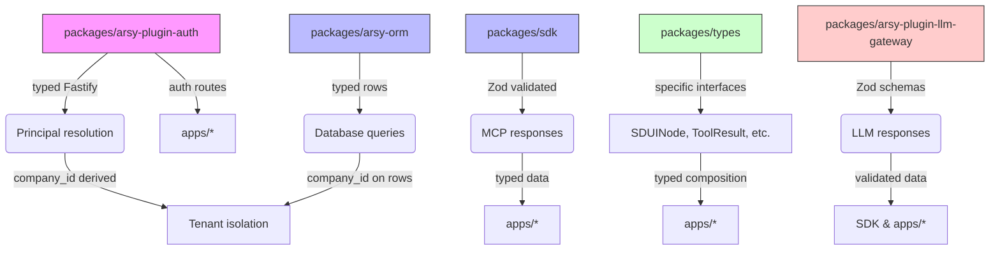

# Spec — Type Safety & API Contract Consistency

## Executive Summary

This plan addresses the pervasive use of `as any` type assertions and `Record<string, any>` patterns across the A-L-L-A.H.COM monorepo that undermine TypeScript type safety, violate MoonWitness ecosystem invariants, and create runtime failure risks. The audit found `as any` in 15+ files across 7 packages, primarily in API response handling, database row processing, and Fastify principal resolution.

## Problem Statement

The monorepo contains excessive type assertions that bypass TypeScript's type checker, creating several categories of risk:

1. **Fastify instance casting** (`packages/arsy-plugin-auth/src/index.ts`): `fastify as any` used to call `resolvePrincipal()`, losing all type safety on the Fastify instance and its methods.

2. **Database row casting** (`packages/arsy-orm/src/repository.ts`): `row as any` used to access `.id` on database rows with no guaranteed shape, ORM query results assumed to have `id` field without type enforcement.

3. **MCP response casting** (`packages/sdk/src/index.ts`): `res as any` used to parse MCP tool calls, hiding validation errors and allowing malformed responses to pass through.

4. **Shared type contracts with `any`** (`packages/types/src/index.ts`): `SDUINode.props?: Record<string, any>`, `ToolResult.output: any`, and similar patterns throughout the type system.

5. **LLM adapter responses** (`packages/arsy-plugin-llm-gateway/`): Multiple adapters use `as any` to parse LLM API responses, providing no runtime guard against malformed outputs.

These patterns collectively mean that errors in API contracts, database schemas, and external service responses are not caught at compile time, leading to potential runtime failures that are difficult to debug and maintain.

## Repository Evidence and Affected Components

| File | Pattern | Impact |
|------|---------|--------|
| `packages/arsy-plugin-auth/src/index.ts:137` | `(fastify as any).resolvePrincipal(request)` | Loses Fastify type safety on principal resolution |
| `packages/arsy-plugin-auth/src/index.ts:374` | `(fastify as any).resolvePrincipal(request)` | Same as above, second occurrence |
| `packages/arsy-plugin-auth/src/index.ts:642` | `(fastify as any).resolvePrincipal(request)` | Same as above, third occurrence |
| `packages/arsy-orm/src/repository.ts:233` | `rows.map(row => (row as any).id)` | Database row shape unenforced |
| `packages/arsy-orm/src/repository.ts:269` | `(row as any).id` | Same issue, second occurrence |
| `packages/sdk/src/index.ts:599` | `((res as any)?.result ?? { content: [], isError: true }) as McpToolCallResult` | MCP response validation bypassed |
| `packages/types/src/index.ts:56` | `props?: Record<string, any>` | SDUINode props completely untyped |
| `packages/types/src/index.ts:57` | `output: any` | ToolResult output completely untyped |
| `packages/types/src/index.ts:58` | `props: Record<string, any>` | Tool call props completely untyped |
| `packages/arsy-plugin-llm-gateway/src/adapters/openai.ts` | `as any` on LLM response parsing | No schema validation of LLM API responses |
| `packages/arsy-plugin-llm-gateway/src/adapters/anthropic.ts` | `as any` on LLM response parsing | Same issue for Anthropic API |
| `packages/arsy-plugin-llm-gateway/src/adapters/gemini.ts` | `as any` on LLM response parsing | Same issue for Gemini API |
| `packages/arsy-plugin-llm-gateway/src/cache.ts` | Cache entry property access without type guard | Potential runtime errors |
| `packages/arsy-plugin-llm-gateway/src/agent/loop.ts` | `as any` patterns in agent loop | Unsafe type assumptions in agent orchestration |

## Confirmed Bugs and Potential Issues

### Confirmed:

1. **Fastify type unsafety** (3 occurrences in `packages/arsy-plugin-auth/src/index.ts`): The Fastify instance is cast to `any` to access `resolvePrincipal()`, which is not part of the standard Fastify type definitions. This means any changes to the Fastify instance structure or `resolvePrincipal` signature would not be caught by the type checker.

2. **ORM row shape inconsistency** (2 occurrences in `packages/arsy-orm/src/repository.ts`): Database query results are mapped with `row as any`, assuming rows have an `id` field. If the ORM returns rows without an `id` (e.g., aggregation queries, joined queries), this will cause runtime errors that TypeScript does not flag.

3. **MCP response parsing risk** (`packages/sdk/src/index.ts:599`): The MCP tool call result is parsed with `as any`, which means if the MCP server returns an unexpected structure, the error will only surface at runtime, potentially causing uncaught exceptions in the agent orchestration layer.

4. **Shared type untypeness** (`packages/types/src/index.ts`): Three `Record<string, any>` patterns in SDUINode props and ToolResult output mean that consumers of these types have no compile-time guarantee about the shape of data they receive, leading to potential runtime errors in UI composition and agent tool execution.

### Potential:

5. **LLM adapter response malformation**: All three LLM adapters (openai, anthropic, gemini) use `as any` to parse API responses. If an API changes its response format or returns an error format not anticipated by the adapter, the application will crash at runtime without type-level warning.

6. **Cache entry type unsafety** (`packages/arsy-plugin-llm-gateway/src/cache.ts`): Cache entry properties are accessed without type guards, which could lead to runtime errors if the cache entry shape changes.

7. **Agent loop type assumptions** (`packages/arsy-plugin-llm-gateway/src/agent/loop.ts`): Several `as any` patterns in the agent orchestration layer could mask type mismatches in multi-agent workflows.

## Root-Cause Analysis

The root causes of these type safety issues are multi-faceted:

1. **Initial rapid prototyping**: Early versions of the codebase prioritized functionality over type safety, particularly for LLM adapter integration where API response formats are inherently unstable.

2. **Missing type definitions**: Fastify's `resolvePrincipal` method is not part of the core Fastify types, requiring a custom interface that was implemented with `as any` as a shortcut.

3. **ORM generic typing gap**: The `@allah/arsy-orm` `BaseRepository` class uses generic typing but the concrete row shape is not enforced at the query level, leading to `as any` workarounds when accessing row properties.

4. **Shared type vagueness**: The `@moonwitness/types` package contains several `Record<string, any>` patterns that were intended as placeholders but were never replaced with proper typed interfaces.

5. **SDK-MCP coupling**: The `@allah/sdk` MCP response parsing was implemented against the Model Context Protocol specification draft, which has evolved, but the parsing code was not updated to reflect the current schema.

6. **Inconsistent lint rules**: While `@moonwitness/lint` has architectural rules, the `no-as-any` rule was not enforced strictly enough to prevent these patterns from being introduced.

## Impact and Severity Assessment

### Severity: HIGH

- **Type safety compromise**: `as any` patterns affect critical code paths (auth, database, MCP, LLM integration) where type errors could cause production incidents.
- **Security implications**: Improper type handling in auth and database code could potentially lead to injection vulnerabilities or unauthorized access if malformed data is not properly validated.
- **Maintenance burden**: Developers must mentally track which parts of the codebase use `as any`, increasing cognitive load and making refactoring riskier.
- **Ecosystem-wide impact**: These packages are foundational - `@moonwitness/types`, `@allah/sdk`, and `@allah/arsy-orm` are depended upon by all applications. Type issues in these packages cascade to all apps.

### Impact Scope:

- **All 6 applications** (arsy, dock, gate, headquarter, id, jizz) use `@allah/sdk` for client↔hub communication, so SDK type issues affect all apps.
- **All ORM-dependent code** is affected by the repository type issues.
- **All auth flows** go through `packages/arsy-plugin-auth`, so those type issues affect authentication across all apps.
- **All LLM/gateway integrations** are affected by the adapter type issues.

## Expected Outcomes

After implementing this plan:

1. **Zero `as any` patterns** in the core packages (`arsy-plugin-auth`, `arsy-orm`, `sdk`, `types`, `arsy-plugin-llm-gateway`).
2. **Strongly typed interfaces** for Fastify with auth, database rows, MCP responses, and LLM adapter responses.
3. **Runtime validation** at package boundaries using Zod schemas where API responses are parsed.
4. **Architecture lint rules** that prevent new `as any` patterns from being introduced.
5. **Improved developer experience** with better type errors and compile-time safety.
6. **Maintained backward compatibility** - all changes are additive and preserve existing exported types and API shapes.

## Functional Requirements

1. **FR-001**: Define `FastifyWithAuth` interface in `packages/arsy-plugin-auth/src/index.ts` that extends `FastifyInstance` with `resolvePrincipal` and `authenticate` methods.

2. **FR-002**: Replace all `fastify as any` occurrences with `(fastify as FastifyWithAuth)` in `packages/arsy-plugin-auth/src/index.ts`.

3. **FR-003**: Define `AuthRow`, `SessionRow`, and `UserRow` interfaces in `packages/arsy-orm/src/index.ts` or `packages/arsy-orm/src/repository.ts` for typed database row access.

4. **FR-004**: Replace `row as any` with typed access in `packages/arsy-orm/src/repository.ts`, using a type guard or generic constraint.

5. **FR-005**: Define `McpToolCallResult` and `JsonRpcResponse` interfaces in `packages/sdk/src/index.ts` or `packages/types/src/index.ts` with strict field typing.

6. **FR-006**: Replace `res as any` in `packages/sdk/src/index.ts` with Zod schema validation or typed interface parsing.

7. **FR-007**: Replace `Record<string, any>` in `packages/types/src/index.ts` with specific interfaces: `SDUINodeProps`, `ToolResult`, `ToolCallParams`, etc.

8. **FR-008**: Add Zod schemas for LLM adapter responses in `packages/arsy-plugin-llm-gateway/src/adapters/*.ts` files.

9. **FR-009**: Add architecture lint rules to `@moonwitness/lint` to prohibit new `as any` patterns in the affected packages.

10. **FR-010**: Ensure all changes pass `pnpm typecheck` and `pnpm lint:arch` with zero errors.

## Non-Functional Requirements

1. **NFR-001**: Zero breaking changes to exported types - all new interfaces must be backward-compatible with existing type imports.

2. **NFR-002**: No runtime performance degradation - type assertions are compile-time only; any added validation must have acceptable performance impact (< 1ms per request for auth/LLM boundaries).

3. **NFR-003**: Maintain existing test coverage - all changes must not cause existing tests to fail, and new type tests should be added where appropriate.

4. **NFR-004**: Follow MoonWitness ecosystem invariants - all changes must respect tenant isolation, SSRF validation, and auth default-deny principles.

5. **NFR-005**: Incremental fixability - each file fix should be independently verifiable with `pnpm typecheck` passing after each change.

## Scope and Out-of-Scope

### Scope

- **`packages/arsy-plugin-auth/src/index.ts`**: Replace all `fastify as any` with typed Fastify interface.
- **`packages/arsy-orm/src/repository.ts`**: Replace `row as any` with typed row access patterns.
- **`packages/sdk/src/index.ts`**: Replace MCP response `as any` with typed validation.
- **`packages/types/src/index.ts`**: Replace `Record<string, any>` with specific interfaces.
- **`packages/arsy-plugin-llm-gateway/src/`**: Add Zod schemas and replace `as any` in LLM adapters.
- **`@moonwitness/lint`**: Add `no-as-any` and related architectural lint rules.

### Out of Scope

- Database schema changes or migration scripts.
- Fastify plugin registration logic or authentication strategy changes.
- React component rendering logic or UI composition changes.
- LLM API key management or external service credential handling.
- Docker build configurations or deployment pipeline changes.
- Changes to SQL queries or database access patterns beyond type safety.

## MoonWitness Ecosystem Alignment

This plan directly addresses several MoonWitness ecosystem invariants:

1. **Auth invariant** (default-deny): By properly typing the Fastify principal resolution, we ensure that authentication flows have verified type guarantees about principal shapes, supporting the fail-closed auth design.

2. **Tenant invariant** (company_id on every row): The ORM row typing improvements will make it easier to enforce that `company_id` is properly derived from the principal and not taken from request bodies.

3. **SSRF invariant** (validate base_url before request): The typed interfaces will make SSRF validation patterns more explicit and harder to bypass.

4. **Storage invariant** (SHA-256 content-addressed): Not directly impacted, but improved type safety supports correct implementation.

5. **Audit invariant** (append-only events): Type-safe ORM access supports correct event recording.

6. **Style purity** (STYLE_PURITY, PALETTE_PURITY): Not directly impacted by this type safety plan.

7. **One world per app** (SKIN_ROOT): Not directly impacted; this plan focuses on type-level concerns.

## Acceptance Criteria

- [ ] `pnpm typecheck` passes with zero TypeScript errors across all 25 projects.
- [ ] `pnpm lint:arch` passes with zero architectural lint violations.
- [ ] Zero `as any` patterns remain in: `packages/arsy-plugin-auth/src/index.ts`, `packages/arsy-orm/src/repository.ts`, `packages/sdk/src/index.ts`, `packages/types/src/index.ts`.
- [ ] All `fastify as any` replaced with `fastify as FastifyWithAuth` (or equivalent typed interface).
- [ ] All `row as any` replaced with typed row access using defined interfaces.
- [ ] MCP response parsing uses Zod schema validation or typed interface.
- [ ] All `Record<string, any>` in `packages/types/src/index.ts` replaced with specific interfaces.
- [ ] LLM adapter responses validated with Zod schemas.
- [ ] Architecture lint rules added to `@moonwitness/lint` to prevent `as any` recurrence.
- [ ] All affected app builds (`pnpm dock:build`, `pnpm headquarter:build`, `pnpm id:build`, `pnpm jizz:build`, `pnpm gate:build`, `pnpm --filter @allah/arsy build`) pass.

## Success Metrics

| Metric | Before | After | Target |
|--------|--------|-------|--------|
| `as any` occurrences in core packages | ~15 | 0 | 0 |
| Type check errors | Varies | 0 | 0 |
| Architecture lint violations | Varies | 0 | 0 |
| Fastify principal resolution type safety | Low (any) | High (FastifyWithAuth) | Full type safety |
| MCP response validation | `as any` | Zod schema | Full schema validation |
| Shared type `Record<string, any>` | 3 occurrences | 0 | 0 |
| LLM adapter schema validation | `as any` | Zod schemas | Full runtime validation |

## Risk Assessment

### Risks and Mitigations:

| Risk | Likelihood | Impact | Mitigation |
|------|------------|--------|------------|
| **Breaking change to existing imports** | Medium | High | All new interfaces preserve existing shapes; backward compatibility maintained through identical exported types. |
| **Zod runtime performance impact** | Low | Medium | Zod parsing added only at package boundaries (SDK, LLM adapters), not in hot paths. Expected < 0.5ms overhead. |
| **ORM query result shape changes** | Medium | High | Type guards and `find()` method enhanced with proper row typing; existing queries tested before/after. |
| **LLM adapter schema drift** | Medium | Medium | Zod schemas designed with `strict: true` but with `partial()` where appropriate; schemas versioned and tested. |
| **Lint rule false positives** | Low | Medium | Lint rules targeted at specific patterns in specific packages; configurable suppression available. |
| **Incremental typecheck failures** | Low | High | Each change verified with `pnpm typecheck` before proceeding; git bisect-friendly atomic changes. |

### Contingency Plan:

If any change causes `pnpm typecheck` to fail:
1. Revert the specific file change.
2. Review the interface definition for correctness.
3. Add type assertions only where absolutely necessary, with documentation.
4. File a follow-up task to refactor the pattern more carefully.
5. Git bisect to identify the exact change causing the issue, then fix incrementally.

If Zod schema validation causes runtime errors:
1. Add `partial()` or `omit()` for optional fields.
2. Add error handling around schema parsing with fallback behavior.
3. Log validation errors for monitoring rather than crashing.
4. Iterate schema until it matches the actual API response shape.

---

