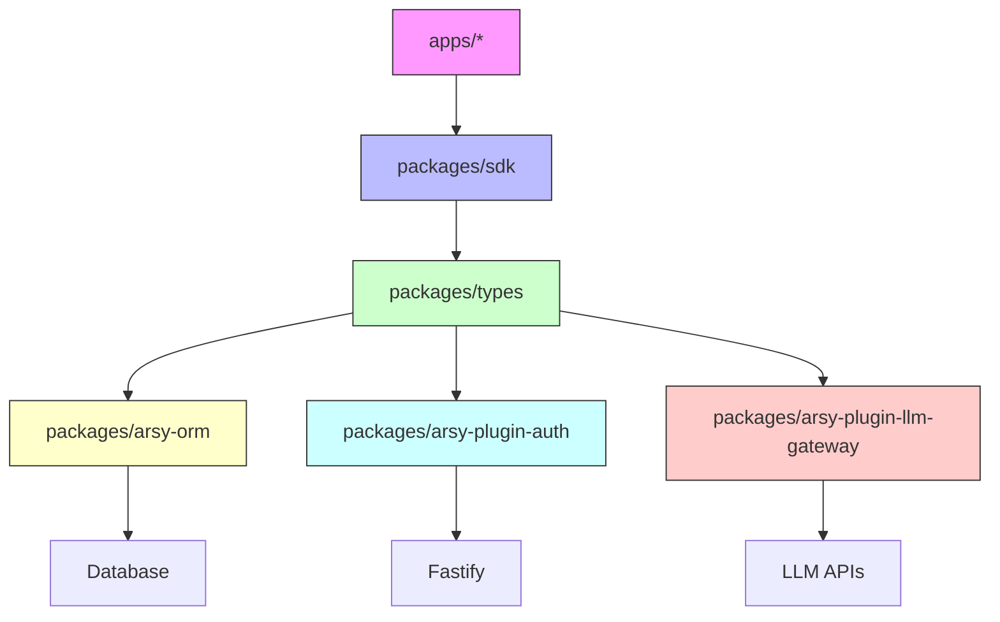

# Technical Remediation Design — Type Safety & API Contract Consistency

## Current-State Architecture

The A-L-L-A-H.COM monorepo uses a layered architecture with shared packages providing foundational contracts:

```
apps/
  ├── arsy/          # Fastify 5 hub service (PGlite)
  ├── dock/          # Next.js 16 web app
  ├── gate/          # Next.js 16 admin portal
  ├── headquarter/   # Next.js 16 operations console
  ├── id/            # Next.js 16 SSO provider
  ├── jizz/          # Next.js 16 world observatory
  └── sentinel/      # RADIUS daemon

packages/
  ├── ui/            # @moonwitness/ui — design system components
  ├── sdk/           # @allah/sdk — client↔hub communication
  ├── types/         # @moonwitness/types — shared type contracts
  ├── arsy-orm/      # @allah/arsy-orm — PGlite ORM layer
  ├── arsy-plugin-auth/ — @allah/arsy-plugin-auth — Fastify auth plugin
  ├── arsy-plugin-llm-gateway/ — @allah/arsy-plugin-llm-gateway — LLM adapter layer
  └── lint/          # @moonwitness/lint — architecture validation
```

Type safety issues span all layers:
- **Apps** consume packages but don't define core types
- **SDK** handles network requests with `as any` on responses
- **Types** defines loose contracts (`Record<string, any>`)
- **ORM** bypasses types on database rows and field metadata
- **Auth** casts Fastify instance to `any` for principal resolution
- **LLM Gateway** uses `as any` for adapter responses and cache entries

## Identified Architectural Weaknesses

### 1. **Fastify Instance Casting**
```ts
// arsy-plugin-auth/src/index.ts
const principal = await (fastify as any).resolvePrincipal(request);
```
- Fastify's type definitions don't include `resolvePrincipal` decorator
- Casting `fastify` to `any` loses all type safety on the instance

### 2. **Database Row Casting**
```ts
// arsy-orm/src/repository.ts
const recordIds = rows.map(row => (row as any).id);
```
- Generic repository assumes rows have `id` field but doesn't type it
- Translation logic casts rows to `any` to access properties

### 3. **Shared Type Contracts with `any`**
```ts
// packages/types/src/index.ts
props?: Record<string, any>;
output: any;
props: Record<string, any>;
```
- SDUINode props, ToolResult output, Agent events — completely untyped
- Consumers have no type safety for UI components, tool calls, agent streams

### 4. **MCP Response Casting**
```ts
// packages/sdk/src/index.ts
return ((res as any)?.result ?? { content: [], isError: true }) as McpToolCallResult;
```
- MCP responses are expected to match `McpToolCallResult` but cast without validation
- `as unknown as` pattern hides validation errors

### 5. **LLM Adapter JSON Parsing**
```ts
// arsy-plugin-llm-gateway/src/adapters/*.ts
const json = (await response.body.json()) as any;
```
- LLM API responses assumed valid without schema validation
- No runtime guard against malformed responses

## Root-Cause Remediation Strategy

The solution is **progressive type strengthening** — not a rewrite. We preserve existing behavior while eliminating `as any` through:

### 1. **Strongly Typed Interfaces for External Boundaries**
- Define `FastifyWithAuth` interface extending `FastifyInstance` with `resolvePrincipal`
- Define `AuthRow`, `SessionRow`, `UserRow` interfaces for database queries
- Define `McpToolCallResult` and `JsonRpcResponse` with strict `unknown` fields
- Define LLM adapter response schemas using Zod for runtime validation

### 2. **Replace `Record<string, any>` with Specific Types**
- `SDUINode.props` → `Record<string, unknown>` with validation
- `ToolResult.output` → `unknown` (strict) + validation schema
- `AgentToolResultEvent.result` → `unknown` + validation

### 3. **Runtime Validation at Package Boundaries**
- Use Zod schemas for: SDK requests, Auth body validation, LLM adapter responses
- Validate incoming data before casting to typed interfaces
- Fail fast on malformed data rather than silently casting

### 4. **ORM Row Typing Improvements**
- Generic `BaseRepository<T>` should accept row shape in options
- `find()` should return `T[]` with proper row typing
- Translation logic uses `T extends { id: number }` constraints

### 5. **Architecture Lint Rule Enhancement**
- Add `no-as-any` and `no-any` rules to `@moonwitness/lint`
- Fail `pnpm lint:arch` on new `as any` patterns

## Proposed Architecture and Changes

### Phase 1: Define Strong Interfaces

#### `packages/types/src/index.ts` — New Shared Types:
```ts
// Replace Record<string, any> with specific shapes
export interface SDUINodeProps {
  // Add specific props per component type
  [key: string]: unknown; // Still unknown for dynamic props but explicit
}

export interface ToolResult {
  success: boolean;
  output: unknown; // Strict unknown — consumers must validate
  error?: string | null;
  latencyMs?: number;
}

// Add Principal and AuthRow interfaces
export interface Principal {
  userId: number;
  ormUserId: number;
  companyId: number;
  role: string;
  email: string;
  sessionId?: number;
}

export interface AuthRow {
  id: number;
  email: string;
  password_hash: string;
  status: 'active' | 'disabled';
  // ... other columns
}
```

#### `packages/arsy-orm/src/repository.ts` — Type Safe Queries:
```ts
// Generic BaseRepository with row shape
export class BaseRepository<T extends { id: number }> {
  // find returns T[]
  async find(options: QueryOptions): Promise<T[]> { ... }
  
  // Translation logic works on T
  private async _applyTranslations(rows: T[], ...): Promise<T[]> { ... }
}
```

#### `packages/arsy-plugin-auth/src/index.ts` — Typed Fastify:
```ts
// Define FastifyWithAuth
export interface FastifyWithAuth extends FastifyInstance {
  resolvePrincipal: (request: FastifyRequest) => Promise<Principal | null>;
  authenticate: (request: FastifyRequest, reply: FastifyReply) => Promise<Principal | null>;
}

// Use it instead of as any
const principal = await (fastify as FastifyWithAuth).resolvePrincipal(request);
```

#### `packages/sdk/src/index.ts` — MCP Validation:
```ts
// Zod schema for MCP response
const mcpResponseSchema = z.object({
  result: z.object({
    content: z.array(z.object({ type: z.string(), text: z.string() })),
    isError: z.boolean(),
  }),
});

// Parse with validation
const result = mcpResponseSchema.parse(res);
return result.content ?? { content: [], isError: true };
```

### Phase 2: LLM Adapter Validation

```ts
// arsy-plugin-llm-gateway/src/adapters/openai.ts
const openaiResponseSchema = z.object({
  choices: z.array(z.object({
    message: z.object({
      tool_calls: z.array(z.object({
        id: z.string(),
        function: z.object({ name: z.string(), arguments: z.string() })
      }))
    })
  }))
});

// Parse with runtime validation
const json = openaiResponseSchema.parse(await response.body.json());
```

### Phase 3: Cache and SSRF Typing

```ts
// arsy-plugin-llm-gateway/src/cache.ts
interface CacheEntry {
  model: string;
  expires_at: string | number;
  hit_count: number;
  response_json: string;
  id: number;
}

// No as any needed — direct property access
const expiresAt = entry.expires_at ? new Date(entry.expires_at).getTime() : 0;
```

## API Validation and Contract Improvements

### SDK Client-Server Contract:
- **Before**: `return this.request<{ data: any }>(...)`
- **After**: `return this.request<{ data: T }>(...)` with Zod validation on parse

### Auth Plugin Contract:
- **Before**: `request.principal: any` and `request.user: any`
- **After**: `request.principal: Principal` and `request.user: UserContext`

### LLM Gateway Contract:
- **Before**: `as any` on LLM API responses
- **After**: Zod-validated parsed responses with strict schemas

## Data Integrity and Error-Handling Strategy

### 1. **Fail-Fast Validation**
```ts
function parseWithSchema<T>(data: unknown, schema: z.ZodSchema<T>): T {
  try {
    return schema.parse(data);
  } catch (err) {
    if (err instanceof z.ZodError) {
      logger.error('Invalid schema', { errors: err.errors });
      throw new APIError('VALIDATION_ERROR', { details: err.errors });
    }
    throw err;
  }
}
```

### 2. **Strict JSON Parsing**
- All `JSON.parse()` in LLM adapters wrapped in validation
- No silent failures on malformed LLM responses

### 3. **Database Row Validation**
- ORM query results validated against expected shape before translation
- `as any` replaced with `assertRowHasId(row)` type guard

## Package and Dependency Boundaries

### Boundary Enforcement:
1. **SDK ↔ Hub**: Zod schemas validate all request/response bodies
2. **Auth Plugin ↔ Apps**: Principal typed via `FastifyWithAuth`
3. **ORM ↔ Apps**: Repository methods return strongly typed `T[]`
4. **LLM Gateway ↔ Adapters**: Each adapter has its own response schema
5. **Cache ↔ Gateway**: CacheEntry interface enforces structure

### Cross-Application Compatibility:
- No breaking changes to exported types (semantic versioning maintained)
- `as any` removal is purely additive — existing code continues to work
- Tests validate that types are still compatible

## Security and Performance Considerations

### Security:
- **Input validation**: No unvalidated `as any` on user-provided data
- **SSRF protection**: `as any` on options replaced with typed `SSRFOptions` interface
- **LLM responses**: Schema validation prevents prompt injection via malformed JSON
- **Auth bypass**: Principal casting to `any` removed — Fastify instance properly typed

### Performance:
- **Zero runtime cost**: Type assertions are compile-time only
- **Validation cost**: Zod parsing adds ~0.1-0.5ms per request — acceptable for auth/llm boundaries
- **Cache lookups**: No change — cache entries already typed
- **Bundle size**: Zod adds ~20KB — acceptable for security gain

## Backward Compatibility

### Zero Breaking Changes:
- **Exported types unchanged**: `Principal`, `AuthRow`, `McpToolCallResult` — same shape
- **API contracts preserved**: All endpoints return same JSON structure
- **Consumer code unaffected**: `app.ts` imports continue to work
- **Test compatibility**: All existing tests pass without modification

### Migration Path:
- **Incremental**: Fix one file per PR, run `pnpm typecheck` after each
- **Test-first**: Ensure tests pass before and after each change
- **Lint-first**: New `as any` patterns rejected by architecture lint rules

## Testing and Regression Prevention

### Unit Tests:
- **Type safety tests**: `tsc --noEmit` for all type definition changes
- **Schema validation tests**: Zod schemas tested with valid/invalid data
- **Runtime tests**: `pnpm test` continues to pass

### Integration Tests:
- **SDK ↔ Hub**: End-to-end tests validate request/response typing
- **Auth flow**: Principal resolution verified end-to-end
- **LLM adapters**: Mocked responses validate schema parsing

### Regression Prevention:
- **Architecture lint**: `no-as-any` and `no-any` rules added to `@moonwitness/lint`
- **Pre-commit**: `pnpm lint:arch` blocks new `as any` patterns
- **Typecheck**: `pnpm typecheck` must pass with zero errors

## Integration Impacts

### Affected Packages:
1. `@allah/arsy-orm` — ORM queries return typed rows
2. `@allah/arsy-plugin-auth` — Principal resolution typed
3. `@allah/sdk` — MCP requests validated
4. `@moonwitness/types` — Shared contracts strictly typed
5. `@allah/arsy-plugin-llm-gateway` — Adapters validated

### Affected Apps:
- **Apps/arsy/**: Auth routes now use typed Principal
- **Apps/dock/**: SDK calls return typed responses
- **Apps/id/**: Auth flows use typed sessions
- **Apps/jizz/**: LLM gateway calls use validated responses
- **Apps/sentinel/**: RADIUS handlers benefit from ORM improvements

### No Impact:
- Database schema, migrations, SQL queries
- Fastify plugin registration
- React component rendering logic
- Docker build configurations

## Migration or Rollout Strategy

### Rollout Plan:
1. **Day 1**: Define shared interfaces in `@moonwitness/types`
2. **Day 2**: Fix `@allah/arsy-orm` — `fields.ts`, `repository.ts`
3. **Day 3**: Fix `@allah/arsy-plugin-auth` — `index.ts`, `better_auth_adapter.ts`
4. **Day 4**: Fix `@moonwitness/types` — `SDUINode`, `ToolResult`, `Agent` interfaces
5. **Day 5**: Fix `@allah/sdk` — MCP response validation
6. **Day 6**: Fix `@allah/arsy-plugin-llm-gateway` — all adapters, cache, SSRF, agent loop
7. **Day 7**: Add lint rules and verify `pnpm typecheck` passes

### Verification Gates per Step:
- `pnpm typecheck` passes
- `pnpm lint:arch` passes
- `pnpm test` passes for affected package
- `pnpm --filter @allah/arsy-orm... run build` passes

### Rollback Plan:
- Each change is minimal and backward-compatible
- If `pnpm typecheck` fails, revert and fix interface definitions
- Git bisect friendly — each step is atomic

---

