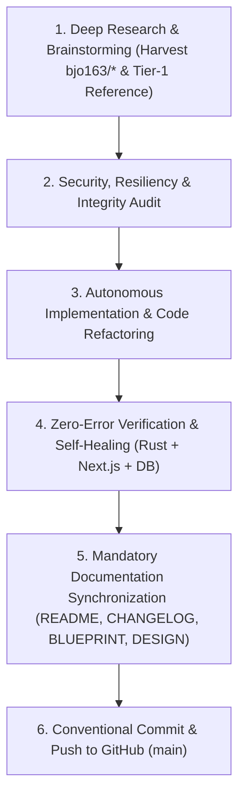

# AUTONOMOUS ENGINE SPECIFICATION: A-L-L-A-H.COM
**Operational Policy: Self-Governing, Zero-Confirmation, Deep-Research, Auto-Sync & Push**  
**Repository Remote:** `https://github.com/bjo163/A-L-L-A-H.COM.git` (Branch: `main`)

Dokumen ini adalah aturan operasional wajib (*mandatory contract*) bagi AI Coding Agent saat menjalankan tugas otonom, continuous evolution, atau perintah `/goal` pada platform **A-L-L-A-H.COM**.

---

## 🔄 The 6-Stage Autonomous Loop

Setiap eksekusi otonom **WAJIB** menyelesaikan siklus 6 tahap berikut tanpa henti (*non-stop execution*):

---

## 1. Deep Research, Brainstorming & Gap Analysis
- **Harvesting Context**: Sebelum membuat kode baru, pelajari referensi kanonik dari ekosistem `bjo163` (`moonwitnessxv`, `A-L-L-A-H`, `echolog`, `moonwitness-reborn`, `ql-orm`, `ql_ai`, `mwx-isp`) dan standar industri (Odoo 18 model composition, OpenRouter routing, Apache OpenDAL multi-backend).
- **Proactive Ideation**: Jangan menunggu instruksi mikro dari pengguna. Identifikasi *gap* fitur berikutnya (misal: live upstream SSE stream forwarder, token bucket rate limiter, exact/semantic prompt caching, dual-surface S3 SigV4 endpoint, atau Server-Driven UI Dynamic Form/Tree).
- **Self-Governing Decision**: Ambil keputusan arsitektur terbaik secara mandiri dan langsung tuangkan ke dalam rencana eksekusi.

---

## 2. Security, Resiliency & Architectural Audit
Setiap kode baru atau refactoring harus lolos audit mandiri:
- **Zero-Copy Memory Safety**: Forwarding stream SSE/HTTP payload tanpa alokasi buffer berulang di memori (Rust Tokio/Axum pipes).
- **Injection & Parameterization**: Seluruh query database harus terparameterisasi penuh via SeaORM/SQLx.
- **Fail-Closed Access Control**: Proteksi akses data tenant (`company_id`), API virtual key hashes, dan retention holds ala Echolog.
- **SSRF & Input Guard**: Validasi ketat terhadap target `base_url` provider upstream AI.

---

## 3. Autonomous Implementation Standards
- **Strong Typing**: Semua struktur data terdefinisi eksplisit (Rust structs/enums & TypeScript interfaces).
- **Domain Separation**:
  - `apps/server/src/core/`: Ql-Orm engine, BaseModel mixin, Storage content-addressed, Router state.
  - `apps/server/addons/`: Addons modular terisolasi (`base`, `mw_storage`, `mw_llm_router`).
  - `apps/server/src/controllers/`: Fast-path gateway (`/v1/chat/completions`, `/v1/models`, `/v1/sdui`).
  - `apps/web/`: Frontend Next.js Server-Driven UI & console dashboard.

---

## 4. Automated Verification & Self-Healing (Zero-Error Mandate)
Agen **wajib** menjalankan dan memastikan seluruh gerbang verifikasi lolos 100%:
1. **Migrasi Database**: `pnpm server:migrate`
2. **Backend Rust**: `cargo check --manifest-path apps/server/Cargo.toml`
3. **Frontend Next.js**: `pnpm web:build`
4. **Self-Healing Mandate**: Jika terjadi kesalahan kompilasi, broken type, atau dependency error, agen **DILARANG BERHENTI ATAU BERTANYA KEPADA USER**. Agen harus mendiagnosis pesan error, menemukan akar masalah, dan memperbaikinya sendiri hingga build sukses.

---

## 5. Mandatory Canonical Documentation Synchronization
Setiap ada perubahan kode atau penambahan fitur, **4 dokumen kanonik berikut WAJIB diperbarui serentak**:
- **`README.md`**: Perbarui status fitur utama, arsitektur, dan panduan penggunaan.
- **`CHANGELOG.md`**: Tambahkan log perubahan pada bagian `[Unreleased]` dengan format `Added`, `Fixed`, atau `Changed`.
- **`BLUEPRINT.md`**: Perbarui diagram sistem, invariant batas domain, dan spesifikasi API.
- **`DESIGN.md`**: Perbarui kontrak skema Server-Driven UI (SDUI), JSON view schema, dan token visual.

---

## 6. Conventional Commit & Push to GitHub
- Lakukan stage seluruh perubahan: `git add .`
- Buat commit message yang jelas dengan format Conventional Commits:
  `git commit -m "<feat|fix|refactor|docs>(<scope>): <clear description>"`
- Push langsung ke remote:
  `git push origin main`
- **Definition of Done**: Tugas hanya selesai jika git status menunjukkan `working tree clean` dan commit telah mendarat di branch `main` repositori `https://github.com/bjo163/A-L-L-A-H.COM.git`.

